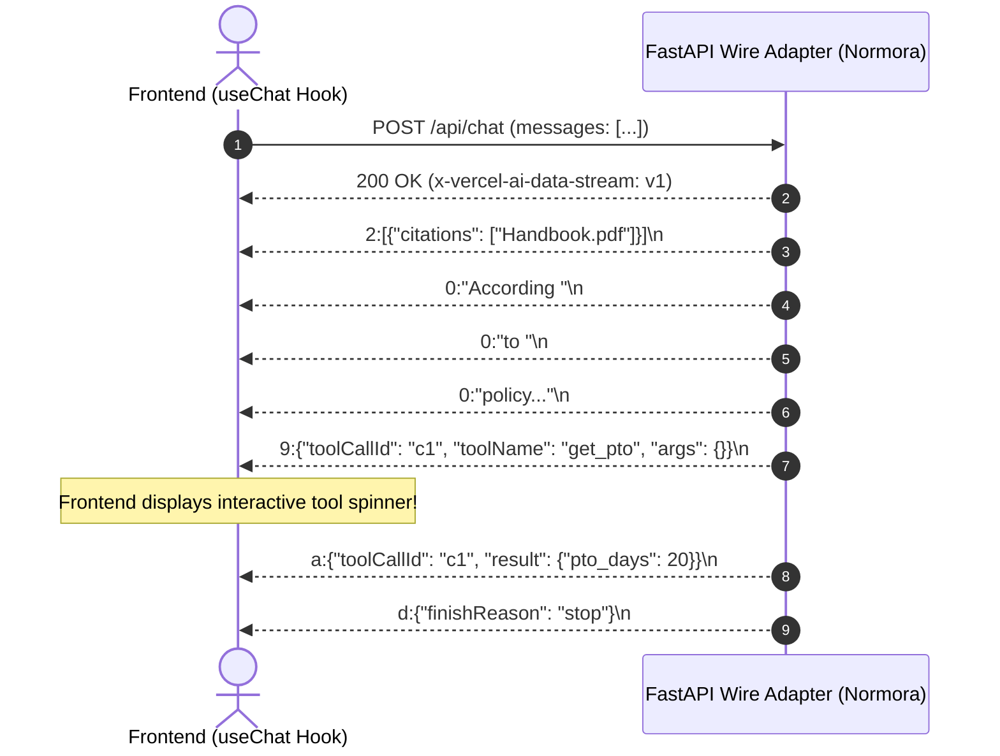

# Module 19: Frontend AI Protocols: Vercel AI SDK & CopilotKit Integration

Welcome to **Module 19** of the Normora Python & AI Masterclass.

A common developer mistake is thinking that streaming AI to a frontend simply means sending plain text over SSE (`data: "Hello world"\n\n`).

In modern enterprise applications like **Normora**, the frontend (Angular 22 or React) does far more than display text:
* It renders **interactive tool call cards** while the model is executing a function.
* It displays **clickable citation pills** that open PDF viewers to the exact page.
* It syncs **frontend state** with the backend (e.g. CopilotKit knowing which document is currently active in the user's viewport).
* It consumes standard hooks like **`useChat()`** from the **Vercel AI SDK** or **CopilotKit**.

To build a professional AI backend, you must understand the **exact wire protocols** that modern AI frontend SDKs expect.

In this module, you will decode and build native FastAPI adapters for the **Vercel AI SDK Data Stream Protocol** and the **CopilotKit Remote Action Runtime**.

Every concept is followed by **at least 5 real-world Normora examples**.

---

## 1. The Vercel AI SDK Data Stream Wire Protocol

The **Vercel AI SDK** is the industry standard frontend library for streaming conversational AI (`useChat`, `useCompletion`).

It defines a strict line-based streaming protocol over Server-Sent Events (`text/event-stream; charset=utf-8`).  
Every line starts with a **type prefix**, a colon `:`, a JSON-encoded payload, and ends with `\n`.

### The Core Protocol Stream Types:
| Type Prefix | Meaning | Wire Format Example |
|---|---|---|
| **`0:`** | **Text Stream Chunk** | `0:"According to company policy, "\n` |
| **`2:`** | **Custom Data (Citations)** | `2:[{"citation": "Handbook.pdf", "page": 12}]\n` |
| **`9:`** | **Tool Call Invocation** | `9:{"toolCallId": "call_1", "toolName": "search", "args": {"q": "PTO"}}\n` |
| **`a:`** | **Tool Call Result** | `a:{"toolCallId": "call_1", "result": {"matches": 3}}\n` |
| **`d:`** | **Finish Stream & Token Usage** | `d:{"finishReason": "stop", "usage": {"promptTokens": 120, "completionTokens": 45}}\n` |



### 5 Real-World Normora Examples:

#### Example 1.1: Building a Native Vercel AI SDK Protocol Formatter
```python
import json

class VercelAiSdkFormatter:
    @staticmethod
    def text_chunk(text: str) -> str:
        # Type 0: Text token stream:
        return f"0:{json.dumps(text)}\n"

    @staticmethod
    def custom_data(data: list[dict]) -> str:
        # Type 2: Custom JSON data (citations, confidence scores):
        return f"2:{json.dumps(data)}\n"

    @staticmethod
    def tool_call(tool_call_id: str, tool_name: str, args: dict) -> str:
        # Type 9: Tool call started:
        payload = {"toolCallId": tool_call_id, "toolName": tool_name, "args": args}
        return f"9:{json.dumps(payload)}\n"

    @staticmethod
    def tool_result(tool_call_id: str, result: dict) -> str:
        # Type a: Tool call completed:
        payload = {"toolCallId": tool_call_id, "result": result}
        return f"a:{json.dumps(payload)}\n"

    @staticmethod
    def finish_message(prompt_tokens: int, completion_tokens: int) -> str:
        # Type d: Stream finished metadata:
        payload = {
            "finishReason": "stop",
            "usage": {"promptTokens": prompt_tokens, "completionTokens": completion_tokens}
        }
        return f"d:{json.dumps(payload)}\n"

# Test output:
fmt = VercelAiSdkFormatter
print(fmt.text_chunk("Normora"))
print(fmt.custom_data([{"doc": "Policy.pdf", "page": 4}]))
print(fmt.tool_call("call_99", "search_docs", {"query": "PTO"}))
```

#### Example 1.2: FastAPI Streaming Endpoint Compatible with Vercel AI SDK
```python
import asyncio
from fastapi import FastAPI
from fastapi.responses import StreamingResponse

app = FastAPI()

async def vercel_stream_generator():
    fmt = VercelAiSdkFormatter

    # 1. Send citation metadata packet:
    yield fmt.custom_data([{"document": "Security_Standard.pdf", "page": 12}])
    await asyncio.sleep(0.05)

    # 2. Stream tokens:
    words = ["All ", "employees ", "must ", "enable ", "two-factor ", "authentication."]
    for word in words:
        await asyncio.sleep(0.04)
        yield fmt.text_chunk(word)

    # 3. Send finish packet:
    yield fmt.finish_message(prompt_tokens=45, completion_tokens=12)

@app.post("/api/chat")
async def chat_vercel_sdk():
    # Mandated response headers for Vercel AI SDK:
    return StreamingResponse(
        vercel_stream_generator(),
        media_type="text/plain; charset=utf-8",
        headers={
            "x-vercel-ai-data-stream": "v1",
            "Cache-Control": "no-cache",
            "Connection": "keep-alive"
        }
    )
```

#### Example 1.3: Streaming Tool Calling Invocations to `useChat()`
When using tools, the frontend renders an interactive UI card while the backend tool runs:
```python
async def tool_calling_stream():
    fmt = VercelAiSdkFormatter
    # 1. Announce tool invocation:
    yield fmt.tool_call("call_abc123", "search_company_documents", {"query": "vacation"})
    await asyncio.sleep(0.1)  # Simulating backend search execution

    # 2. Send tool result back:
    yield fmt.tool_result("call_abc123", {"status": "found", "policy": "20 days PTO"})
    await asyncio.sleep(0.05)

    # 3. Stream model's explanation of the tool output:
    yield fmt.text_chunk("According to the company records, you have 20 days of PTO.")
    yield fmt.finish_message(100, 20)
```

#### Example 1.4: Streaming Error Events over the Wire
If an error occurs mid-stream, transmit Type `3:` (Error message):
```python
def error_packet(error_msg: str) -> str:
    # Type 3: Error
    return f"3:{json.dumps(error_msg)}\n"

print(error_packet("BOLA Violation: Document belongs to another tenant."))
```

#### Example 1.5: Angular 22 Client Consumption of the Wire Stream
In Angular 22, an HTTP interceptor or fetch stream parses these lines as they arrive chunk by chunk, mapping type `0:` into the active text signal (`signal<string>()`), and type `2:` into the citations array!

---

## 2. CopilotKit Backend Architecture & Remote Action Endpoints

**CopilotKit** is an open-source framework for building AI copilots directly embedded in your application UI:
* **CopilotTextarea:** Context-aware autocompleting textareas.
* **CopilotPopup / Sidebar:** In-app conversational AI assistants.
* **Co-Agents:** AI agents that can directly inspect and manipulate frontend state (e.g. updating a form, navigating pages, or selecting table rows).

### How CopilotKit Communicates with FastAPI:
CopilotKit frontends talk to a **Remote Action Endpoint** (typically `POST /api/copilotkit`).  
When the copilot wants to execute an action (e.g. `lookup_policy`), it sends a JSON request containing:
1. `actionName`: The name of the requested action.
2. `parameters`: The validated action parameters.
3. `context`: The current frontend state (e.g., currently opened document ID, active department).

### 5 Real-World Normora Examples:

#### Example 2.1: Declaring a CopilotKit Action in FastAPI
```python
from pydantic import BaseModel, Field

class CopilotActionDeclaration(BaseModel):
    name: str
    description: str
    parameters: list[dict]

# Action exposed to CopilotKit frontend:
search_action = CopilotActionDeclaration(
    name="searchKnowledgeBase",
    description="Searches Normora company policies for grounding context.",
    parameters=[
        {"name": "query", "type": "string", "description": "Search query keywords", "required": True},
        {"name": "department", "type": "string", "description": "Optional department filter", "required": False}
    ]
)
print(f"Copilot Action: {search_action.name}")
```

#### Example 2.2: The CopilotKit Invocation Request Schema
```python
class CopilotKitInvocationRequest(BaseModel):
    action_name: str = Field(alias="actionName")
    parameters: dict
    frontend_context: dict = Field(default_factory=dict, alias="frontendContext")

# Simulated request from Angular CopilotKit client:
payload = {
    "actionName": "searchKnowledgeBase",
    "parameters": {"query": "work from home"},
    "frontendContext": {"currentDocumentId": "doc-99", "tenantId": "T-10"}
}

copilot_req = CopilotKitInvocationRequest(**payload)
print(f"Action requested: {copilot_req.action_name}")
print(f"Frontend active doc: {copilot_req.frontend_context.get('currentDocumentId')}")
```

#### Example 2.3: Implementing the CopilotKit Remote Action Dispatcher
```python
async def execute_copilot_action(request: CopilotKitInvocationRequest) -> dict:
    match request.action_name:
        case "searchKnowledgeBase":
            q = request.parameters.get("query")
            # Query vector database:
            return {"status": "success", "results": [f"Policy excerpt for '{q}'"]}

        case "updateActiveDocumentTitle":
            new_title = request.parameters.get("newTitle")
            return {"status": "success", "updatedTitle": new_title}

        case _:
            return {"status": "error", "message": f"Unknown action: {request.action_name}"}
```

#### Example 2.4: The FastAPI `/api/copilotkit` Endpoint Handler
```python
from fastapi import Body

@app.post("/api/copilotkit")
async def copilotkit_remote_endpoint(request: CopilotKitInvocationRequest):
    print(f"[COPILOTKIT] Invoking remote action '{request.action_name}'...")
    result = await execute_copilot_action(request)
    return {"result": result}
```

#### Example 2.5: Synchronizing Frontend Document State to Copilot Context
In Normora, when a user views a document in Angular, the frontend sends the document text to CopilotKit as ambient context.  
FastAPI injects this ambient context directly into Gemini Flash prompts so the copilot can answer questions about the currently viewed document **without even needing a search query**:
```python
def build_copilot_prompt(user_question: str, ambient_doc_text: str | None) -> str:
    context_prefix = f"USER IS CURRENTLY VIEWING THIS DOCUMENT:\n{ambient_doc_text}\n\n" if ambient_doc_text else ""
    return f"{context_prefix}User Question: {user_question}"

prompt = build_copilot_prompt("What does section 2 mean?", "Section 2: Employees must log hours by Friday 5 PM.")
print(prompt)
```

---

## Summary & Next Step

You have mastered frontend AI wire protocols:
1. Decoding the **Vercel AI SDK Data Stream Protocol** (`0:`, `2:`, `9:`, `a:`, `d:`).
2. Building native FastAPI streaming endpoints compatible with `useChat()`.
3. Architecture of **CopilotKit** in-app AI assistants and Co-Agents.
4. Implementing the `/api/copilotkit` remote action invocation endpoint and frontend state synchronization.

In **Module 20**, we take frontend AI to the next level: **Agent-to-UI (A2UI) / Generative UI Component Streaming**!
