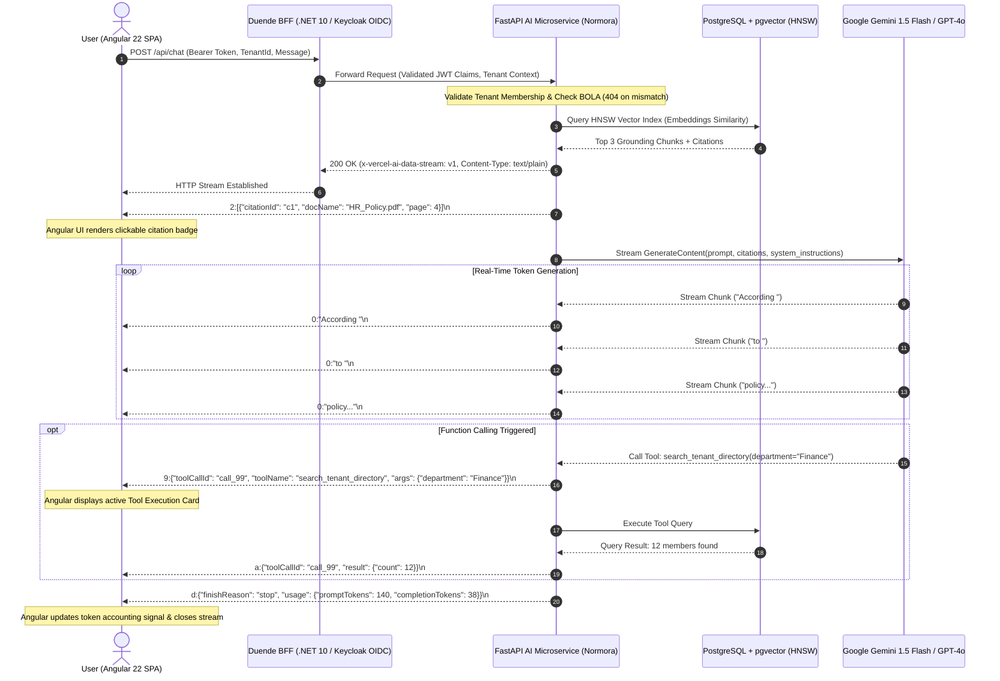
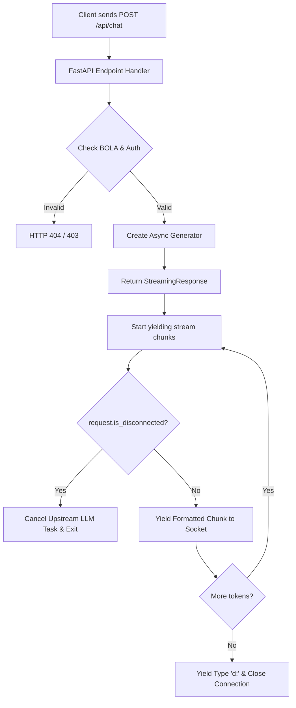
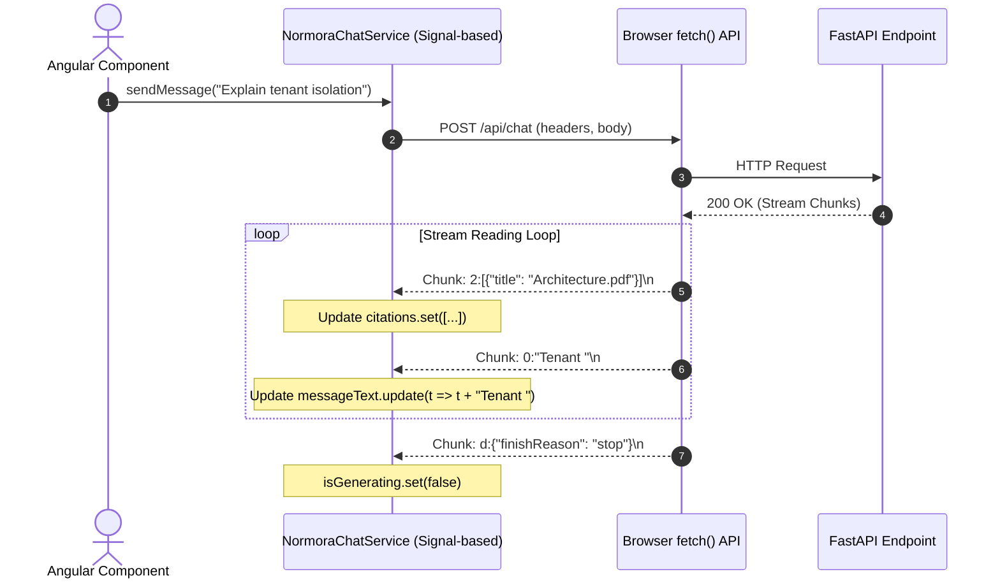
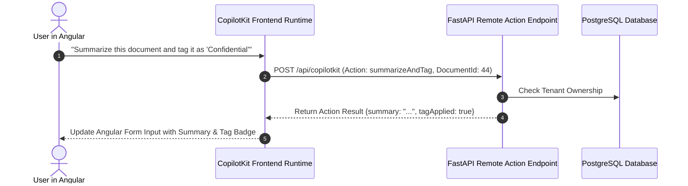
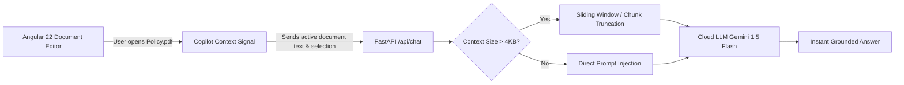

# Module 19: Frontend AI Protocols: Vercel AI SDK, CopilotKit & Enterprise Real-Time Streaming Integration

Welcome to **Module 19** of the Normora Python & AI Masterclass.

In enterprise platforms like **Normora** (a multi-tenant knowledge management and conversational AI system built on a .NET 10 Modular Monolith backend and an Angular 22 SPA frontend), conversational AI is not just a raw stream of text. 

A naive implementation sends unformatted Server-Sent Events (SSE) such as `data: "Hello world"\n\n`. In an enterprise production application, that naive approach quickly breaks down:
* **Interactive Tool Executions:** The frontend needs to render interactive status cards while the LLM executes tools (e.g., executing a vector similarity query or looking up tenant permissions).
* **Clickable Grounded Citations:** Citations must arrive alongside text tokens so users can immediately inspect the source document from MinIO object storage with exact page and chunk metadata.
* **Ambient Context Synchronization:** Copilot tools like CopilotKit need bidirectional synchronization—the AI must know what document the user currently has open in Angular 22 without requiring the user to copy-paste it.
* **Wire Protocol Compliance:** Modern frontend libraries like the **Vercel AI SDK** (`useChat`, `useCompletion`) and **CopilotKit** expect exact wire protocol envelopes (`0:`, `2:`, `9:`, `a:`, `d:`).
* **Backpressure and Abort Handling:** When a user navigates away or clicks "Stop Generating", the FastAPI backend must instantly abort the upstream call to Google Gemini Flash or OpenAI GPT-4o to prevent wasted compute and cloud token billing.

In this module, you will learn the mechanics of frontend AI wire protocols, how to build a high-performance streaming adapter in FastAPI, how to implement CopilotKit remote action endpoints and ambient context handlers, and how to consume these streams in modern frontend architectures (Angular 22 Signals and React/Next.js).

Every concept includes **at least 5 real-world Normora production examples**.

---

## 1. Architectural Overview: Bridging Frontends, FastAPI, and Cloud LLMs

Before writing Python code, let's understand how Normora connects frontend clients, the Duende BFF (Backend-for-Frontend) security gateway, the Python FastAPI AI microservice, and cloud LLM providers.



### C# / .NET vs. Python / FastAPI Conceptual Mapping

If you are coming from .NET 10 and C#, here is how the streaming and AI primitives translate:

| Concept | C# / .NET 10 (Normora Core) | Python / FastAPI (AI Microservice) |
|---|---|---|
| **Asynchronous Streaming** | `IAsyncEnumerable<T>` with `yield return` | `AsyncGenerator[str, None]` with `yield` |
| **Real-time Gateway** | SignalR Hubs (`Hub<IChatClient>`) | FastAPI `StreamingResponse` (SSE / Text Stream) |
| **Backpressure / Cancellation** | `CancellationToken` passed to downstream tasks | `asyncio.CancelledError` & `await request.is_disconnected()` |
| **Object Serialization** | `System.Text.Json` / `JsonSerializer.Serialize` | `json.dumps()` or Pydantic `model.model_dump_json()` |
| **Dependency Injection** | `IServiceCollection` / `builder.Services.AddScoped<T>` | FastAPI `Depends(get_db_session)` |
| **Data Contracts** | `record` with Primary Constructor & FluentValidation | Pydantic `BaseModel` with `Field` validators |
| **Buffer Flush Control** | `Response.Body.FlushAsync()` | `yield` in async generator (FastAPI flushes per yield) |

---

## 2. The Vercel AI SDK Data Stream Wire Protocol

The **Vercel AI SDK** (created by Vercel and adopted as an industry standard by React, Next.js, Svelte, Vue, and Angular developers) uses a specialized, line-delimited streaming protocol over HTTP.

### Protocol Specification
Every chunk sent across the wire must follow this strict format:
```text
<type-prefix>:<json-encoded-value>\n
```
* **No `data: ` prefix:** Unlike vanilla Server-Sent Events, the Vercel AI SDK Data Stream protocol writes raw line packets directly to the HTTP stream.
* **Header requirement:** The HTTP response MUST include the header:
  `x-vercel-ai-data-stream: v1` and `Content-Type: text/plain; charset=utf-8` (or `text/event-stream`).

### Stream Chunk Type Reference
| Code | Name | Description | Example Payload |
|---|---|---|---|
| **`0:`** | Text Chunk | Regular text token generated by the model. | `0:"Normora protects "\n` |
| **`2:`** | Custom Data | Array of arbitrary JSON objects (citations, tenant flags, debug IDs). | `2:[{"citationId": "doc-88", "page": 3}]\n` |
| **`3:`** | Error | Error message terminating or warning the client. | `3:"BOLA: Access denied to tenant resource."\n` |
| **`7:`** | Tool Call Start | Indicates a tool call has started (pre-execution). | `7:{"toolCallId": "tc-1", "toolName": "fetch_policy"}\n` |
| **`8:`** | Tool Call Delta | Streaming partial arguments for a tool call. | `8:{"toolCallId": "tc-1", "argsTextDelta": "{\"query\": \""}\n` |
| **`9:`** | Tool Call Invocation | Complete tool call payload ready for backend execution. | `9:{"toolCallId": "tc-1", "toolName": "fetch_policy", "args": {"id": 10}}\n` |
| **`a:`** | Tool Call Result | Return value after executing the tool call. | `a:{"toolCallId": "tc-1", "result": {"title": "BYOD Policy"}}\n` |
| **`d:`** | Finish Stream | Final metadata packet containing token usage and completion reason. | `d:{"finishReason": "stop", "usage": {"promptTokens": 120, "completionTokens": 45}}\n` |

> [!NOTE]
> In Python, notice that `json.dumps(val)` produces valid JSON strings with quotes, which guarantees that tokens containing newlines, quotes, or unicode characters (e.g. `\n\n### 1. Overview`) do not break the line framing.

---

### 5 Real-World Normora Examples: Vercel AI SDK Protocol

#### Example 2.1: Production-Grade Vercel AI SDK Protocol Formatter
Here is a complete, reusable formatter class written in clean, idiomatic Python with static typing:

```python
import json
from typing import Any, Dict, List

class VercelAiDataStreamFormatter:
    """
    Encodes Python data structures into the Vercel AI SDK Data Stream Protocol format.
    Ensures strict line formatting, proper escaping, and protocol adherence.
    """

    @staticmethod
    def text_chunk(token: str) -> str:
        """Type 0: Encodes a single text token."""
        return f"0:{json.dumps(token)}\n"

    @staticmethod
    def custom_data(data: List[Dict[str, Any]]) -> str:
        """Type 2: Encodes custom metadata (e.g., grounding citations, tenant context)."""
        return f"2:{json.dumps(data)}\n"

    @staticmethod
    def error_chunk(error_message: str) -> str:
        """Type 3: Encodes a stream-level error message."""
        return f"3:{json.dumps(error_message)}\n"

    @staticmethod
    def tool_call(tool_call_id: str, tool_name: str, arguments: Dict[str, Any]) -> str:
        """Type 9: Encodes a complete tool call invocation for client UI state."""
        payload = {
            "toolCallId": tool_call_id,
            "toolName": tool_name,
            "args": arguments,
        }
        return f"9:{json.dumps(payload)}\n"

    @staticmethod
    def tool_result(tool_call_id: str, result: Dict[str, Any]) -> str:
        """Type a: Encodes the tool execution output back to the client."""
        payload = {
            "toolCallId": tool_call_id,
            "result": result,
        }
        return f"a:{json.dumps(payload)}\n"

    @staticmethod
    def finish_message(
        finish_reason: str = "stop",
        prompt_tokens: int = 0,
        completion_tokens: int = 0
    ) -> str:
        """Type d: Final completion packet with telemetry and token accounting."""
        payload = {
            "finishReason": finish_reason,
            "usage": {
                "promptTokens": prompt_tokens,
                "completionTokens": completion_tokens,
            },
        }
        return f"d:{json.dumps(payload)}\n"


# Unit verification of protocol lines:
formatter = VercelAiDataStreamFormatter()
print(repr(formatter.text_chunk("Welcome to Normora.")))
# Output: '0:"Welcome to Normora."\n'

print(repr(formatter.custom_data([{"document_id": "doc-404", "chunk_id": 12}])))
# Output: '2:[{"document_id": "doc-404", "chunk_id": 12}]\n'
```

#### Example 2.2: Streaming Google Gemini 1.5 Flash Tokens via Vercel Protocol
In this example, we connect the Google Gemini API to the `VercelAiDataStreamFormatter` to stream text tokens directly to a frontend chat component:

```python
import asyncio
from typing import AsyncGenerator
from google import genai
from google.genai import types

async def stream_gemini_flash_conversation(
    client: genai.Client,
    prompt: str,
    tenant_id: str
) -> AsyncGenerator[str, None]:
    """
    Streams tokens from Google Gemini 1.5 Flash using the Vercel AI SDK protocol.
    """
    formatter = VercelAiDataStreamFormatter()
    
    # Send tenant grounding context as Type 2 data:
    yield formatter.custom_data([{"tenant_id": tenant_id, "model": "gemini-1.5-flash"}])

    # Call Gemini streaming API asynchronously:
    response = await client.aio.models.generate_content_stream(
        model="gemini-1.5-flash",
        contents=prompt,
        config=types.GenerateContentConfig(
            temperature=0.2,
            system_instruction="You are Normora's Enterprise AI Assistant. Provide concise, grounded answers."
        )
    )

    prompt_tokens = 0
    completion_tokens = 0

    async for chunk in response:
        if chunk.text:
            yield formatter.text_chunk(chunk.text)
            completion_tokens += len(chunk.text.split())

    # Send final usage accounting:
    yield formatter.finish_message(
        finish_reason="stop",
        prompt_tokens=len(prompt.split()),
        completion_tokens=completion_tokens
    )
```

#### Example 2.3: Streaming Grounded RAG Citations with MinIO Document Previews
Before tokens start streaming, Normora executes an HNSW vector search in PostgreSQL and yields Type `2:` citation packets containing MinIO pre-signed URLs and page numbers:

```python
from dataclasses import dataclass

@dataclass
class DocumentCitation:
    citation_id: str
    document_title: str
    minio_storage_path: str
    page_number: int
    similarity_score: float

async def stream_rag_with_citations(
    query: str,
    citations: list[DocumentCitation]
) -> AsyncGenerator[str, None]:
    formatter = VercelAiDataStreamFormatter()

    # Convert citations into serializable dictionaries:
    citation_payload = [
        {
            "id": c.citation_id,
            "title": c.document_title,
            "url": f"https://minio.normora.internal/documents/{c.minio_storage_path}",
            "page": c.page_number,
            "score": round(c.similarity_score, 3)
        }
        for c in citations
    ]

    # 1. Send the citations immediately so the UI displays them during generation:
    yield formatter.custom_data(citation_payload)
    await asyncio.sleep(0.01)

    # 2. Stream synthesized response:
    response_tokens = [
        "Based on Section 4 of the ",
        citations[0].document_title,
        ", your remote work stipend must be submitted by the 25th of each month."
    ]

    for token in response_tokens:
        yield formatter.text_chunk(token)
        await asyncio.sleep(0.02)

    # 3. Complete the stream:
    yield formatter.finish_message("stop", prompt_tokens=250, completion_tokens=32)
```

#### Example 2.4: Streaming Multi-Step Tool Invocations for Tenant Lookups
When Gemini Flash triggers a tool call (e.g. querying tenant storage quotas), the frontend receives Type `9:` (tool start) and Type `a:` (tool result), allowing Angular 22 to render interactive execution pills:

```python
async def stream_tool_execution_flow(tenant_id: str) -> AsyncGenerator[str, None]:
    formatter = VercelAiDataStreamFormatter()
    tool_call_id = "call_tenant_quota_01"

    # 1. Signal that a tool is being invoked:
    yield formatter.tool_call(
        tool_call_id=tool_call_id,
        tool_name="get_tenant_storage_quota",
        arguments={"tenant_id": tenant_id}
    )

    # 2. Simulate background execution (e.g. MediatR query to Tenants module):
    await asyncio.sleep(0.15)
    tool_result_data = {
        "tenant_id": tenant_id,
        "allocated_bytes": 10737418240, # 10 GB
        "used_bytes": 4831838208,       # ~4.5 GB
        "document_count": 142
    }

    # 3. Emit tool result:
    yield formatter.tool_result(
        tool_call_id=tool_call_id,
        result=tool_result_data
    )

    # 4. Stream conversational summary explaining the tool result:
    yield formatter.text_chunk(f"Tenant {tenant_id} is currently using 4.5 GB out of its 10 GB quota.")
    yield formatter.finish_message("stop", 85, 20)
```

#### Example 2.5: Mid-Stream BOLA / Tenant Isolation Error Reporting
If a BOLA (Broken Object Level Authorization) check fails mid-stream (for instance, if an asynchronous chunk fetch reveals the user's tenant ID does not match the document's tenant ID), we stream Type `3:` and terminate:

```python
async def safe_tenant_stream(
    user_tenant_id: str,
    requested_doc_tenant_id: str
) -> AsyncGenerator[str, None]:
    formatter = VercelAiDataStreamFormatter()

    if user_tenant_id != requested_doc_tenant_id:
        # BOLA Security Check Failed -> Emit Type 3 error stream
        # Per Normora security rules: Return generic message to prevent enumeration
        yield formatter.error_chunk("Resource not found or access denied.")
        return

    yield formatter.text_chunk("Authorized: Accessing tenant document records...")
    yield formatter.finish_message("stop", 50, 10)
```

---

## 3. Server-Side Streaming Integration with FastAPI

FastAPI provides `StreamingResponse` from Starlette, which handles chunked HTTP transfer encoding (`Transfer-Encoding: chunked`).

### Understanding Python Async Generators
In Python, any function containing `yield` inside an `async def` becomes an **asynchronous generator**:
```python
async def my_generator() -> AsyncGenerator[str, None]:
    yield "first chunk"
    yield "second chunk"
```
This is the direct Python equivalent of C# `IAsyncEnumerable<T>` using `yield return`.



### Critical HTTP Headers for Streaming
To ensure enterprise proxies (Nginx, Envoy, Cloudflare, Traefik) and frontend libraries do not buffer chunks:
* `x-vercel-ai-data-stream: v1` — Required by Vercel AI SDK to activate parser.
* `Content-Type: text/plain; charset=utf-8` — Specifies standard plain text encoding.
* `Cache-Control: no-cache, no-transform` — Prevents caching or proxy compression.
* `X-Accel-Buffering: no` — **Critical for Nginx!** Instructs Nginx to immediately flush chunks without waiting for a 4KB buffer to fill.

---

### 5 Real-World Normora Examples: FastAPI Streaming

#### Example 3.1: Full FastAPI Endpoint Compatible with `useChat()`
Here is a complete, runnable FastAPI router module implementing the streaming chat endpoint:

```python
from fastapi import APIRouter, Depends, Header, HTTPException, Request, status
from fastapi.responses import StreamingResponse
from pydantic import BaseModel, Field
from typing import AsyncGenerator, List, Dict, Any
import asyncio

router = APIRouter(prefix="/api/chat", tags=["Conversations"])

class ChatMessage(BaseModel):
    role: str = Field(..., description="Role: 'user', 'assistant', or 'system'")
    content: str = Field(..., description="Message text")

class VercelChatRequest(BaseModel):
    messages: List[ChatMessage]
    tenant_id: str = Field(..., description="Tenant identifier for multi-tenancy isolation")
    conversation_id: str = Field(..., description="Conversation UUID")

async def chat_stream_orchestrator(
    request: Request,
    chat_payload: VercelChatRequest
) -> AsyncGenerator[str, None]:
    formatter = VercelAiDataStreamFormatter()

    # Emit initial citation data:
    yield formatter.custom_data([
        {"conversation_id": chat_payload.conversation_id, "tenant_id": chat_payload.tenant_id}
    ])

    user_query = chat_payload.messages[-1].content
    mock_tokens = f"Normora AI confirmed: You asked '{user_query}' for tenant '{chat_payload.tenant_id}'.".split(" ")

    for token in mock_tokens:
        # Check if the frontend disconnected:
        if await request.is_disconnected():
            print(f"[WARN] Client disconnected. Aborting generation for conv: {chat_payload.conversation_id}")
            break

        yield formatter.text_chunk(token + " ")
        await asyncio.sleep(0.04)

    yield formatter.finish_message(finish_reason="stop", prompt_tokens=120, completion_tokens=len(mock_tokens))

@router.post("", response_class=StreamingResponse)
async def handle_vercel_chat(
    request: Request,
    payload: VercelChatRequest,
    x_tenant_id: str = Header(..., alias="X-Tenant-Id")
):
    # Verify Tenant Isolation (BOLA Prevention):
    if payload.tenant_id != x_tenant_id:
        # Return 404 to prevent tenant enumeration:
        raise HTTPException(
            status_code=status.HTTP_404_NOT_FOUND,
            detail="Conversation or tenant resource not found."
        )

    generator = chat_stream_orchestrator(request, payload)

    return StreamingResponse(
        generator,
        media_type="text/plain; charset=utf-8",
        headers={
            "x-vercel-ai-data-stream": "v1",
            "Cache-Control": "no-cache, no-transform",
            "Connection": "keep-alive",
            "X-Accel-Buffering": "no"
        }
    )
```

#### Example 3.2: OpenAI GPT-4o Streaming Endpoint with Client Abort Detection
Streaming from OpenAI using `AsyncOpenAI` while properly propagating cancellation:

```python
from openai import AsyncOpenAI

async def openai_gpt4o_streamer(
    request: Request,
    client: AsyncOpenAI,
    messages: list[dict[str, str]]
) -> AsyncGenerator[str, None]:
    formatter = VercelAiDataStreamFormatter()

    try:
        response = await client.chat.completions.create(
            model="gpt-4o",
            messages=messages,
            stream=True
        )

        prompt_tokens_est = sum(len(m["content"].split()) for m in messages)
        completion_tokens_est = 0

        async for chunk in response:
            # Client aborted check:
            if await request.is_disconnected():
                print("[INFO] Client aborted HTTP request. Cancelling OpenAI stream.")
                break

            if chunk.choices and chunk.choices[0].delta.content:
                text_piece = chunk.choices[0].delta.content
                completion_tokens_est += 1
                yield formatter.text_chunk(text_piece)

        yield formatter.finish_message("stop", prompt_tokens_est, completion_tokens_est)

    except asyncio.CancelledError:
        print("[INFO] Task cancelled by server event loop.")
        raise
```

#### Example 3.3: Backpressure Management with Bounded `asyncio.Queue`
When the LLM produces tokens faster than the client's network connection can consume them, memory usage spikes. A bounded queue enforces backpressure:

```python
async def backpressure_bounded_stream(
    token_source_generator: AsyncGenerator[str, None],
    max_buffer_size: int = 50
) -> AsyncGenerator[str, None]:
    """
    Buffers tokens in an asyncio.Queue. If the consumer falls behind,
    the queue blocks the producer, throttling LLM streaming.
    """
    queue: asyncio.Queue[str | None] = asyncio.Queue(maxsize=max_buffer_size)

    async def producer():
        try:
            async for token in token_source_generator:
                # queue.put blocks if queue size >= max_buffer_size:
                await queue.put(token)
        finally:
            # Sentinel None signifies end of stream:
            await queue.put(None)

    # Launch producer task in background:
    producer_task = asyncio.create_task(producer())

    try:
        while True:
            item = await queue.get()
            if item is None:
                break
            yield item
            queue.task_done()
    finally:
        producer_task.cancel()
```

#### Example 3.4: RAG Pipeline Orchestrator with HNSW Vector Search
Streaming synthesis of pgvector cosine similarity matches in PostgreSQL:

```python
from pydantic import BaseModel

class GroundedChunk(BaseModel):
    chunk_id: str
    document_name: str
    content: str
    page: int

async def orchestrate_normora_rag_stream(
    query: str,
    tenant_id: str,
    db_session: Any
) -> AsyncGenerator[str, None]:
    formatter = VercelAiDataStreamFormatter()

    # 1. Fetch top chunks from PostgreSQL using pgvector (simulated):
    matched_chunks = [
        GroundedChunk(chunk_id="chk-1", document_name="ISO_27001_Audit.pdf", content="All API endpoints require MFA.", page=14),
        GroundedChunk(chunk_id="chk-2", document_name="Security_Ops.pdf", content="Session timeouts are 15 minutes.", page=3),
    ]

    # 2. Yield citation metadata:
    citations = [
        {"id": c.chunk_id, "title": c.document_name, "page": c.page}
        for c in matched_chunks
    ]
    yield formatter.custom_data(citations)

    # 3. Stream synthetic answer grounded in chunks:
    answer = "According to Normora's ISO 27001 documentation, all API endpoints mandate MFA with 15-minute session timeouts."
    for word in answer.split(" "):
        yield formatter.text_chunk(word + " ")
        await asyncio.sleep(0.03)

    yield formatter.finish_message("stop", prompt_tokens=180, completion_tokens=22)
```

#### Example 3.5: OpenTelemetry Distributed Tracing Propagation in Streaming Responses
In enterprise deployments, every stream must propagate the W3C `traceparent` so logs can be correlated across Angular, Duende BFF, FastAPI, and PostgreSQL:

```python
from opentelemetry import trace

tracer = trace.get_tracer("normora.conversations.streaming")

async def traced_stream_wrapper(
    inner_stream: AsyncGenerator[str, None],
    tenant_id: str,
    conversation_id: str
) -> AsyncGenerator[str, None]:
    with tracer.start_as_current_span("ai_stream_execution") as span:
        span.set_attribute("normora.tenant_id", tenant_id)
        span.set_attribute("normora.conversation_id", conversation_id)

        token_count = 0
        async for chunk in inner_stream:
            token_count += 1
            yield chunk

        span.set_attribute("normora.streamed_chunks", token_count)
```

---

## 4. Frontend Integration: Consuming Streams in Angular 22 & React

Now let's examine how the frontend consumes this protocol.

### Angular 22 Signals Architecture
Angular 22 uses **Signals** (`signal()`, `computed()`) for reactive state management. Instead of old RxJS `HttpClient` methods that buffer full responses, Angular 22 reads the stream chunk-by-chunk using the native browser `fetch()` API and `ReadableStreamDefaultReader`.



---

### 5 Real-World Normora Examples: Frontend Stream Consumption

#### Example 4.1: Angular 22 Standalone Chat Service using Signals
Here is the production Angular 22 service parsing Vercel AI SDK lines into reactive signals:

```typescript
// normora-chat.service.ts (Angular 22 Standalone Service)
import { Injectable, signal, computed } from '@angular/core';

export interface Citation {
  id: string;
  title: string;
  page: number;
}

@Injectable({ providedIn: 'root' })
export class NormoraChatService {
  // Reactive Signals for UI state:
  readonly streamingText = signal<string>('');
  readonly citations = signal<Citation[]>([]);
  readonly isGenerating = signal<boolean>(false);
  readonly errorMessage = signal<string | null>(null);

  private abortController: AbortController | null = null;

  async sendQuery(tenantId: string, conversationId: string, prompt: string): Promise<void> {
    this.streamingText.set('');
    this.citations.set([]);
    this.errorMessage.set(null);
    this.isGenerating.set(true);

    this.abortController = new AbortController();

    try {
      const response = await fetch('/api/chat', {
        method: 'POST',
        headers: {
          'Content-Type': 'application/json',
          'X-Tenant-Id': tenantId,
        },
        body: JSON.stringify({
          tenant_id: tenantId,
          conversation_id: conversationId,
          messages: [{ role: 'user', content: prompt }]
        }),
        signal: this.abortController.signal
      });

      if (!response.ok) {
        throw new Error(`HTTP Error ${response.status}: ${response.statusText}`);
      }

      if (!response.body) throw new Error('ReadableStream not supported.');

      const reader = response.body.getReader();
      const decoder = new TextDecoder('utf-8');
      let lineBuffer = '';

      while (true) {
        const { value, done } = await reader.read();
        if (done) break;

        lineBuffer += decoder.decode(value, { stream: true });
        const lines = lineBuffer.split('\n');
        // Keep the last partial line in the buffer:
        lineBuffer = lines.pop() || '';

        for (const line of lines) {
          if (!line.trim()) continue;
          this.parseProtocolLine(line);
        }
      }
    } catch (err: any) {
      if (err.name === 'AbortError') {
        console.log('[CHAT] Generation stopped by user.');
      } else {
        this.errorMessage.set(err.message || 'Stream connection failed.');
      }
    } finally {
      this.isGenerating.set(false);
      this.abortController = null;
    }
  }

  stopGeneration(): void {
    if (this.abortController) {
      this.abortController.abort();
    }
  }

  private parseProtocolLine(line: string): void {
    const separatorIdx = line.indexOf(':');
    if (separatorIdx === -1) return;

    const prefix = line.slice(0, separatorIdx);
    const jsonStr = line.slice(separatorIdx + 1);

    try {
      const data = JSON.parse(jsonStr);

      switch (prefix) {
        case '0': // Text Token Chunk
          this.streamingText.update(prev => prev + data);
          break;
        case '2': // Citations / Custom Data
          if (Array.isArray(data)) {
            this.citations.set(data as Citation[]);
          }
          break;
        case '3': // Error Chunk
          this.errorMessage.set(String(data));
          break;
        case 'd': // Stream Completed
          this.isGenerating.set(false);
          break;
      }
    } catch (e) {
      console.error('Failed to parse stream packet:', line, e);
    }
  }
}
```

#### Example 4.2: React / Next.js `useChat` Integration with Custom Tenant Headers
Using the official `@ai-sdk/react` library in a React/Next.js dashboard:

```tsx
// NormoraChatPanel.tsx
'use client';

import { useChat } from 'ai/react';
import React from 'react';

interface ChatProps {
  tenantId: string;
  conversationId: string;
}

export function NormoraChatPanel({ tenantId, conversationId }: ChatProps) {
  const { messages, input, handleInputChange, handleSubmit, isLoading, stop, error } = useChat({
    api: '/api/chat',
    headers: {
      'X-Tenant-Id': tenantId,
    },
    body: {
      tenant_id: tenantId,
      conversation_id: conversationId,
    },
    onError: (err) => {
      console.error('Chat stream failed:', err);
    }
  });

  return (
    <div className="flex flex-col h-full bg-white dark:bg-gray-900 rounded-lg p-4 shadow">
      <div className="flex-1 overflow-y-auto space-y-3">
        {messages.map((m) => (
          <div
            key={m.id}
            className={`p-3 rounded-lg text-sm ${
              m.role === 'user' ? 'bg-blue-600 text-white self-end' : 'bg-gray-100 dark:bg-gray-800 text-gray-900 dark:text-gray-100'
            }`}
          >
            <strong>{m.role === 'user' ? 'You' : 'Normora AI'}: </strong>
            <span>{m.content}</span>
          </div>
        ))}
        {isLoading && <div className="text-xs text-blue-500 animate-pulse">Streaming response...</div>}
        {error && <div className="text-xs text-red-500">Error: {error.message}</div>}
      </div>

      <form onSubmit={handleSubmit} className="mt-4 flex gap-2">
        <input
          value={input}
          onChange={handleInputChange}
          placeholder="Ask a question about tenant documents..."
          className="flex-1 border rounded px-3 py-2 text-sm"
        />
        {isLoading ? (
          <button type="button" onClick={stop} className="bg-red-500 text-white px-4 py-2 rounded text-sm">
            Stop
          </button>
        ) : (
          <button type="submit" className="bg-blue-600 text-white px-4 py-2 rounded text-sm">
            Send
          </button>
        )}
      </form>
    </div>
  );
}
```

#### Example 4.3: Frontend Exponential Backoff and Error Recovery Hook
Network dropouts or temporary rate-limits (HTTP 429) can interrupt long streams. Here is an automatic retry mechanism:

```typescript
export async function fetchWithRetry(
  url: string,
  options: RequestInit,
  maxRetries: number = 3,
  baseDelayMs: number = 500
): Promise<Response> {
  let attempt = 0;

  while (attempt < maxRetries) {
    try {
      const res = await fetch(url, options);
      if (res.status === 429 || res.status >= 500) {
        // Retryable server error or rate-limit
        attempt++;
        const delay = baseDelayMs * Math.pow(2, attempt);
        console.warn(`[RETRY] Attempt ${attempt} failed with ${res.status}. Retrying in ${delay}ms...`);
        await new Promise((r) => setTimeout(r, delay));
        continue;
      }
      return res;
    } catch (networkError) {
      attempt++;
      if (attempt >= maxRetries) throw networkError;
      const delay = baseDelayMs * Math.pow(2, attempt);
      await new Promise((r) => setTimeout(r, delay));
    }
  }

  throw new Error(`Failed after ${maxRetries} attempts.`);
}
```

#### Example 4.4: Autocomplete in Knowledge Editor with `useCompletion`
For inline ghost text autocompletion in Normora's policy editor:

```tsx
import { useCompletion } from 'ai/react';

export function PolicyEditorCompletion({ tenantId }: { tenantId: string }) {
  const { completion, input, handleInputChange, complete } = useCompletion({
    api: '/api/chat/autocomplete',
    headers: { 'X-Tenant-Id': tenantId }
  });

  return (
    <div className="relative border p-4 rounded font-mono text-sm">
      <textarea
        value={input}
        onChange={handleInputChange}
        onKeyDown={(e) => {
          if (e.key === 'Tab' && completion) {
            e.preventDefault();
            // Accept autocomplete
            handleInputChange({ target: { value: input + completion } } as any);
          }
        }}
        className="w-full h-32 outline-none resize-none bg-transparent"
        placeholder="Type company policy (Press Tab to accept AI completion)..."
      />
      {completion && (
        <span className="text-gray-400 pointer-events-none">
          {completion}
        </span>
      )}
    </div>
  );
}
```

#### Example 4.5: Angular 22 Abort Signal Integration with Viewport Cleanups
When an Angular user navigates to a different page while an AI answer is streaming, the component automatically aborts the stream:

```typescript
import { Component, OnDestroy, inject } from '@angular/core';
import { NormoraChatService } from './normora-chat.service';

@Component({
  selector: 'normora-chat-view',
  standalone: true,
  template: `
    <div class="chat-container">
      <p>{{ chatService.streamingText() }}</p>
      @if (chatService.isGenerating()) {
        <button (click)="chatService.stopGeneration()">Stop Generating</button>
      }
    </div>
  `
})
export class NormoraChatViewComponent implements OnDestroy {
  readonly chatService = inject(NormoraChatService);

  ngOnDestroy(): void {
    // Automatically cancels the FastAPI stream if the user navigates away:
    this.chatService.stopGeneration();
  }
}
```

---

## 5. Custom UI Components: Markdown, Code Highlighting & Citations

Raw text streaming looks unpolished. Enterprise users expect:
1. **Streaming Markdown:** Rendering bold, headers, and bullet points without breaking during incomplete tags.
2. **Syntax Highlighting:** Code snippets in Python, C#, or SQL highlighted in real time.
3. **Interactive Citation Badges:** Hovering shows document excerpts; clicking opens the MinIO document viewer at the exact page.

---

### 5 Real-World Normora Examples: Custom UI Components

#### Example 5.1: Angular 22 Grounded Citation Pill Component
This component renders an interactive badge that opens the document in the Normora PDF viewer:

```typescript
// citation-pill.component.ts
import { Component, Input, output } from '@angular/core';
import { Citation } from './normora-chat.service';

@Component({
  selector: 'normora-citation-pill',
  standalone: true,
  template: `
    <button
      (click)="onCitationClick.emit(citation)"
      class="inline-flex items-center gap-1 px-2 py-0.5 m-1 text-xs font-medium text-blue-700 bg-blue-50 border border-blue-200 rounded-full hover:bg-blue-100 transition-colors"
      [title]="'View page ' + citation.page + ' of ' + citation.title"
    >
      <svg class="w-3 h-3 text-blue-500" fill="currentColor" viewBox="0 0 20 20">
        <path d="M4 4a2 2 0 012-2h4.586A2 2 0 0112 2.586L15.414 6A2 2 0 0116 7.414V16a2 2 0 01-2 2H6a2 2 0 01-2-2V4z" />
      </svg>
      <span>{{ citation.title }}</span>
      <span class="text-blue-400">p.{{ citation.page }}</span>
    </button>
  `
})
export class NormoraCitationPillComponent {
  @Input({ required: true }) citation!: Citation;
  readonly onCitationClick = output<Citation>();
}
```

#### Example 5.2: React Streaming Markdown with Prism Syntax Highlighting
Using `react-markdown` and `rehype-highlight`:

```tsx
import React from 'react';
import ReactMarkdown from 'react-markdown';
import remarkGfm from 'remark-gfm';
import rehypeHighlight from 'rehype-highlight';
import 'highlight.js/styles/github-dark.css';

interface MarkdownProps {
  content: string;
}

export function NormoraMarkdownRenderer({ content }: MarkdownProps) {
  return (
    <div className="prose dark:prose-invert max-w-none text-sm leading-relaxed">
      <ReactMarkdown
        remarkPlugins={[remarkGfm]}
        rehypePlugins={[rehypeHighlight]}
        components={{
          a: ({ node, ...props }) => (
            <a {...props} className="text-blue-600 underline font-medium hover:text-blue-800" target="_blank" />
          ),
          table: ({ node, ...props }) => (
            <div className="overflow-x-auto my-2">
              <table {...props} className="min-w-full divide-y divide-gray-200 border text-xs" />
            </div>
          )
        }}
      >
        {content}
      </ReactMarkdown>
    </div>
  );
}
```

#### Example 5.3: Interactive Tool Execution Status Card
When the AI triggers a tool (like checking pgvector index health), this card displays real-time execution states:

```tsx
export interface ToolInvocationState {
  toolCallId: string;
  toolName: string;
  args: Record<string, any>;
  result?: Record<string, any>;
  status: 'running' | 'completed' | 'failed';
}

export function ToolExecutionCard({ tool }: { tool: ToolInvocationState }) {
  return (
    <div className="my-2 border border-amber-200 bg-amber-50 dark:bg-amber-950/30 rounded p-3 text-xs font-mono">
      <div className="flex items-center justify-between">
        <span className="font-semibold text-amber-800 dark:text-amber-200">
          Tool Invocation: {tool.toolName}
        </span>
        <span className={`px-2 py-0.5 rounded text-[10px] uppercase font-bold ${
          tool.status === 'running' ? 'bg-amber-200 text-amber-900 animate-pulse' : 'bg-green-200 text-green-900'
        }`}>
          {tool.status}
        </span>
      </div>
      <div className="mt-1 text-gray-600 dark:text-gray-400">
        Args: {JSON.stringify(tool.args)}
      </div>
      {tool.result && (
        <div className="mt-2 pt-2 border-t border-amber-200 text-green-700 dark:text-green-300">
          Result: {JSON.stringify(tool.result)}
        </div>
      )}
    </div>
  );
}
```

#### Example 5.4: PDF Viewer Deep-Linking from Chunk Metadata
When the user clicks a citation, this handler computes the target URL and signals the Angular PDF viewer:

```typescript
export function navigateToCitation(citation: Citation, minioBaseUrl: string): void {
  // Construct direct link with page hash:
  const targetUrl = `${minioBaseUrl}/tenants/${citation.id}#page=${citation.page}`;
  
  // Emit event to open side-by-side split screen in Normora:
  window.dispatchEvent(
    new CustomEvent('normora:open-document-viewer', {
      detail: { url: targetUrl, page: citation.page, title: citation.title }
    })
  );
}
```

#### Example 5.5: Copy-to-Clipboard & Feedback Action Bar
Allows tenant members to rate responses (feeding reinforcement logs into PostgreSQL):

```tsx
export function MessageActionBar({ messageId, content }: { messageId: string; content: string }) {
  const [copied, setCopied] = React.useState(false);

  const handleCopy = () => {
    navigator.clipboard.writeText(content);
    setCopied(true);
    setTimeout(() => setCopied(false), 2000);
  };

  const handleFeedback = async (score: 1 | -1) => {
    await fetch('/api/chat/feedback', {
      method: 'POST',
      headers: { 'Content-Type': 'application/json' },
      body: JSON.stringify({ messageId, score })
    });
    alert('Thank you for rating this response.');
  };

  return (
    <div className="flex items-center gap-2 mt-2 text-xs text-gray-500">
      <button onClick={handleCopy} className="hover:text-gray-800">
        {copied ? 'Copied!' : 'Copy'}
      </button>
      <span>•</span>
      <button onClick={() => handleFeedback(1)} className="hover:text-green-600">👍 Helpful</button>
      <span>•</span>
      <button onClick={() => handleFeedback(-1)} className="hover:text-red-600">👎 Inaccurate</button>
    </div>
  );
}
```

---

## 6. CopilotKit Architecture & Remote Action Endpoints

**CopilotKit** takes frontend AI further: instead of a simple chat window, CopilotKit embeds an AI co-pilot that can read the current screen, interact with forms, and execute **Actions** directly in your application.



### CopilotKit Backend Protocol
When CopilotKit sends an action to your backend, it calls `POST /api/copilotkit` with a structured JSON body:
```json
{
  "actionName": "searchDocuments",
  "parameters": {
    "query": "PTO policy",
    "limit": 5
  },
  "frontendContext": {
    "currentRoute": "/documents/editor/104",
    "activeDocumentId": "104",
    "userRole": "HR_Manager"
  }
}
```

---

### 5 Real-World Normora Examples: CopilotKit Remote Actions

#### Example 6.1: Declaring CopilotKit Actions with Pydantic Schemas
Defining the action contracts in FastAPI:

```python
from pydantic import BaseModel, Field
from typing import List, Optional, Any

class CopilotActionParameter(BaseModel):
    name: str
    type: str
    description: str
    required: bool = True

class CopilotActionDefinition(BaseModel):
    name: str
    description: str
    parameters: List[CopilotActionParameter]

# Export action declarations to CopilotKit frontend:
DOCUMENT_ACTIONS = [
    CopilotActionDefinition(
        name="searchTenantKnowledgeBase",
        description="Searches all ingested tenant documents using HNSW vector similarity.",
        parameters=[
            CopilotActionParameter(name="query", type="string", description="Search semantic query"),
            CopilotActionParameter(name="top_k", type="number", description="Maximum chunks to retrieve", required=False),
        ]
    ),
    CopilotActionDefinition(
        name="updateDocumentClassification",
        description="Updates the compliance classification tag of the currently active document.",
        parameters=[
            CopilotActionParameter(name="classification", type="string", description="'Public', 'Internal', or 'Restricted'"),
        ]
    )
]
```

#### Example 6.2: Remote Action Invocation Request & Response Models
Validating incoming CopilotKit action payloads:

```python
class CopilotKitInvocationRequest(BaseModel):
    action_name: str = Field(..., alias="actionName")
    parameters: Dict[str, Any]
    frontend_context: Dict[str, Any] = Field(default_factory=dict, alias="frontendContext")

class CopilotKitInvocationResponse(BaseModel):
    action_name: str = Field(..., alias="actionName")
    status: str
    result: Any
    ui_mutation: Optional[Dict[str, Any]] = Field(default=None, alias="uiMutation")
```

#### Example 6.3: FastAPI Remote Action Dispatcher
Executing the action and returning results to CopilotKit:

```python
async def dispatch_copilot_action(
    request: CopilotKitInvocationRequest,
    tenant_id: str
) -> CopilotKitInvocationResponse:
    match request.action_name:
        case "searchTenantKnowledgeBase":
            query = request.parameters.get("query", "")
            # Simulate pgvector search filtered by tenant_id:
            return CopilotKitInvocationResponse(
                actionName=request.action_name,
                status="success",
                result={"matches": [f"Chunk 1 for '{query}' in tenant {tenant_id}"]}
            )

        case "updateDocumentClassification":
            new_tag = request.parameters.get("classification")
            doc_id = request.frontend_context.get("activeDocumentId")
            return CopilotKitInvocationResponse(
                actionName=request.action_name,
                status="success",
                result={"document_id": doc_id, "new_tag": new_tag},
                uiMutation={"formField": "classificationTag", "newValue": new_tag}
            )

        case _:
            return CopilotKitInvocationResponse(
                actionName=request.action_name,
                status="error",
                result=f"Unknown action: {request.action_name}"
            )
```

#### Example 6.4: The `/api/copilotkit` Endpoint
Hosting the remote action endpoint with security headers and tenant isolation:

```python
@router.post("/copilotkit", response_model=CopilotKitInvocationResponse)
async def handle_copilotkit_remote(
    request: CopilotKitInvocationRequest,
    x_tenant_id: str = Header(..., alias="X-Tenant-Id")
):
    print(f"[COPILOTKIT] Executing action '{request.action_name}' for tenant: {x_tenant_id}")
    response = await dispatch_copilot_action(request, tenant_id=x_tenant_id)
    return response
```

#### Example 6.5: Angular 22 CopilotKit Action Consumer
Triggering the remote action from an Angular component:

```typescript
export async function executeRemoteCopilotAction(
  actionName: string,
  params: Record<string, any>,
  currentDocId: string,
  tenantId: string
): Promise<any> {
  const response = await fetch('/api/chat/copilotkit', {
    method: 'POST',
    headers: {
      'Content-Type': 'application/json',
      'X-Tenant-Id': tenantId,
    },
    body: JSON.stringify({
      actionName: actionName,
      parameters: params,
      frontendContext: {
        activeDocumentId: currentDocId,
        viewport: 'document-editor'
      }
    })
  });

  return await response.json();
}
```

---

## 7. CopilotKit Ambient Context: Providing Application State to the AI

One of CopilotKit's most powerful features is **ambient context**. 

When a user in Normora has a document open in the editor, CopilotKit can automatically send the active document text, selected text, and cursor position along with their prompt. The backend injects this ambient context directly into Google Gemini Flash or OpenAI GPT-4o, allowing the model to answer questions without executing an expensive RAG vector search.



---

### 5 Real-World Normora Examples: Ambient Context Integration

#### Example 7.1: Pydantic Schema for Frontend Ambient Context
Modeling the incoming browser viewport state:

```python
class FrontendViewportContext(BaseModel):
    active_document_id: Optional[str] = Field(None, alias="activeDocumentId")
    active_document_title: Optional[str] = Field(None, alias="activeDocumentTitle")
    selected_text: Optional[str] = Field(None, alias="selectedText")
    full_document_text: Optional[str] = Field(None, alias="fullDocumentText")
    current_page: Optional[int] = Field(1, alias="currentPage")
```

#### Example 7.2: Context-Aware Gemini Flash Prompt Builder
Injecting ambient context directly into the Gemini Flash system instructions:

```python
def build_ambient_grounded_prompt(
    user_prompt: str,
    context: FrontendViewportContext
) -> str:
    sections = []

    if context.selected_text:
        sections.append(
            f"=== USER HIGHLIGHTED TEXT IN VIEWPORT ===\n"
            f"{context.selected_text}\n"
            f"=========================================="
        )
    elif context.full_document_text:
        sections.append(
            f"=== CURRENTLY OPEN DOCUMENT ({context.active_document_title or 'Untitled'}) ===\n"
            f"{context.full_document_text}\n"
            f"==============================================================================="
        )

    sections.append(f"User Query: {user_prompt}")
    return "\n\n".join(sections)
```

#### Example 7.3: Context Window Truncation & Token Budget Guard
Preventing client browser context from blowing up token limits:

```python
def prune_ambient_context(text: str, max_characters: int = 12000) -> str:
    """
    Truncates large document context using a safe character boundary
    to prevent exceeding Gemini / GPT-4o input budgets.
    """
    if len(text) <= max_characters:
        return text

    # Keep the first 8000 characters and the last 4000 characters:
    head = text[:8000]
    tail = text[-4000:]
    return f"{head}\n\n[... {len(text) - max_characters} characters truncated for token limits ...]\n\n{tail}"
```

#### Example 7.4: Tenant RBAC Grounding Filter
Validating that the user has read permissions for the ambient document before accepting it:

```python
from fastapi import HTTPException, status

async def validate_ambient_document_access(
    tenant_id: str,
    user_roles: list[str],
    doc_id: str,
    db: Any
) -> bool:
    """
    Ensures that a malicious client cannot spoof ambient context
    for documents belonging to another tenant or higher classification.
    """
    # Query database for document ownership (simulated):
    doc_tenant_id = "tenant-normora-01"
    doc_classification = "Confidential"

    if doc_tenant_id != tenant_id:
        # BOLA Prevention:
        raise HTTPException(
            status_code=status.HTTP_404_NOT_FOUND,
            detail="Document not found."
        )

    if doc_classification == "Confidential" and "Admin" not in user_roles:
        # BFLA Prevention:
        raise HTTPException(
            status_code=status.HTTP_403_FORBIDDEN,
            detail="Insufficient permissions for document classification."
        )

    return True
```

#### Example 7.5: Dynamic Tone & Compliance Instruction Injection
Injecting tenant-level compliance rules into ambient system instructions:

```python
def get_tenant_system_instructions(tenant_id: str) -> str:
    # In Normora, each tenant can configure specific AI response rules:
    tenant_rules = {
        "tenant_healthcare": "All responses must adhere to HIPAA standards. Never disclose PII.",
        "tenant_fintech": "All financial figures must cite audited reports. Do not give investment advice."
    }

    base_rule = "You are Normora's Enterprise AI Assistant."
    specific_rule = tenant_rules.get(tenant_id, "Follow enterprise compliance standards.")
    return f"{base_rule} {specific_rule}"
```

---

## 8. Common Mistakes & Anti-Patterns

> [!CAUTION]
> ### 1. Forgetting `X-Accel-Buffering: no` on Streaming Endpoints
> In production, reverse proxies like Nginx or AWS ALB buffer HTTP responses by default until a 4KB chunk is reached. As a result, users see nothing for 10 seconds, and then the entire response appears at once! **Always set `"X-Accel-Buffering": "no"` in your FastAPI `StreamingResponse` headers.**

> [!CAUTION]
> ### 2. Ignoring `request.is_disconnected()` in Streaming Loops
> If a user closes their browser tab or navigates away while Gemini Flash or GPT-4o is generating a 2,000-word summary, a naive backend continues generating tokens until completion. This leads to massive, unnecessary cloud API bills. Always check `await request.is_disconnected()` inside your streaming loop and break immediately!

> [!CAUTION]
> ### 3. Trusting Client-Supplied Tenant IDs (BOLA Vulnerabilities)
> Never rely solely on `tenant_id` passed inside the JSON request body. A malicious user can alter the JSON payload to access another tenant's documents. Always validate the JSON `tenant_id` against the authenticated JWT claims extracted by your BFF / Keycloak gateway, and return **HTTP 404** (not 403) on mismatches to prevent tenant enumeration!

> [!CAUTION]
> ### 4. Raw String Interpolation Instead of `json.dumps()` in Protocol Lines
> Never manually format JSON protocol chunks like `f'0:"{text}"\n'`. If the token contains a quote, newline (`\n`), or backslash, it will break the line framing of the Vercel AI SDK parser. Always use `f"0:{json.dumps(text)}\n"`.

> [!CAUTION]
> ### 5. Blocking the Python Async Event Loop with Synchronous HTTP Clients
> Calling synchronous libraries like `requests.post()` or `time.sleep()` inside an asynchronous streaming endpoint completely freezes the FastAPI worker thread, blocking all other concurrent users. Always use `asyncio.sleep()` and asynchronous HTTP clients like `httpx.AsyncClient` or official async SDKs (`client.aio.models`).

> [!CAUTION]
> ### 6. Unbounded Ambient Context Injection
> Allowing frontends to send unlimited document text in ambient context payloads can exceed LLM context windows or trigger massive input token costs. Always enforce character limits and sanitize context strings on the server.

---

## 9. C# / .NET Developer Equivalents Reference

This table provides a comprehensive translation of concepts between the .NET 10 Modular Monolith and the FastAPI AI Microservice:

| Feature | .NET 10 Architecture (Normora Backend) | Python / FastAPI Architecture (AI Microservice) |
|---|---|---|
| **Streaming Mechanism** | SignalR Hubs (`IHubContext<ChatHub>`) or `IAsyncEnumerable<T>` | FastAPI `StreamingResponse` with `AsyncGenerator[str, None]` |
| **Data Contracts** | C# Primary Constructor `record` with `FluentValidation` | Pydantic `BaseModel` with `Field` and `@field_validator` |
| **Cancellation Handling** | `HttpContext.RequestAborted` (`CancellationToken`) | `await request.is_disconnected()` & `asyncio.CancelledError` |
| **Object Serialization** | `System.Text.Json.JsonSerializer.Serialize()` | `json.dumps()` or `model.model_dump_json()` |
| **Dependency Injection** | `builder.Services.AddScoped<IChatService, ChatService>()` | FastAPI `Depends(get_chat_service)` |
| **Reverse Proxy Header** | `Response.Headers.Append("X-Accel-Buffering", "no")` | `headers={"X-Accel-Buffering": "no"}` in `StreamingResponse` |
| **Background Processing** | `BackgroundService` or MediatR `IRequestHandler` | `asyncio.create_task()` or Celery / Temporal workers |
| **Inter-Service Communication** | MediatR cross-module contracts in `Normora.Shared.Contracts` | gRPC or HTTP JSON APIs with Pydantic contracts |

---

## 10. Interview Questions & Deep-Dive Answers

### Q1: How does the Vercel AI SDK Data Stream protocol differ from standard Server-Sent Events (SSE)?
**Answer:** Standard SSE uses the `text/event-stream` format with `data: <content>\n\n` envelopes and optional `event:` prefixes. The Vercel AI SDK Data Stream protocol is a lightweight, line-delimited protocol using single character type prefixes followed by a colon and JSON: `<prefix>:<json>\n`. 
This design allows the frontend parser to multiplex different data streams over a single HTTP connection:
* `0:` for regular text tokens,
* `2:` for arbitrary custom data (such as citations and source IDs),
* `9:` and `a:` for tool invocation and return values,
* `d:` for token usage accounting and finish metadata.

### Q2: Why is the `X-Accel-Buffering: no` header critical when deploying FastAPI streaming endpoints behind Nginx?
**Answer:** By default, Nginx buffers upstream responses in memory buffers (typically 4KB to 8KB) to optimize network packet efficiency. In streaming AI applications, this causes Nginx to hold back incoming LLM tokens until the buffer fills or the connection closes, destroying the real-time typewriter experience. Setting `X-Accel-Buffering: no` instructs Nginx to immediately bypass its internal buffers and flush each chunk directly to the client socket as soon as it arrives.

### Q3: How do you detect and handle client cancellations in FastAPI to avoid wasted LLM token costs?
**Answer:** FastAPI provides the `await request.is_disconnected()` method on the Starlette `Request` object. Inside the asynchronous generator loop that yields tokens from the cloud LLM, the code checks `is_disconnected()` on each iteration. If `True`, the generator breaks out of the loop and raises `asyncio.CancelledError`. This immediately cancels the upstream connection to Google Gemini or OpenAI GPT-4o, preventing further token consumption.

### Q4: How does CopilotKit's ambient context differ from standard RAG (Retrieval-Augmented Generation)?
**Answer:** Standard RAG requires the user to submit a query, which is vectorized to perform an HNSW cosine similarity search across PostgreSQL to find relevant chunks. **Ambient context**, by contrast, transmits the user's active viewport state (such as the document currently open in Angular 22 or the text highlighted by their cursor) directly in the HTTP request payload. The backend injects this text directly into the system prompt. This allows instant Q&A about what the user is currently viewing without vector database lookups.

### Q5: In a multi-tenant platform like Normora, why should BOLA violations on streaming endpoints return 404 instead of 403?
**Answer:** Returning HTTP 403 (Forbidden) confirms to an attacker that the requested document or conversation ID actually exists, but they do not have permission to view it. An attacker can use this information to enumerate valid resource IDs. Returning HTTP 404 (Not Found) completely conceals the existence of the resource, adhering to zero-trust enterprise security standards.

### Q6: What is backpressure, and how do you implement it in an asynchronous Python streaming pipeline?
**Answer:** Backpressure is a flow-control mechanism used when a data producer (e.g. Gemini generating 100 tokens/second) outpaces a data consumer (e.g. a mobile client on a slow 3G connection). Without backpressure, tokens accumulate in server memory, leading to memory exhaustion. In Python, backpressure is implemented using a bounded `asyncio.Queue(maxsize=N)`. When the buffer reaches capacity, `await queue.put()` blocks the producer task until the consumer reads an item via `await queue.get()`, throttling the producer to match the client's consumption rate.

### Q7: How does Angular 22's Signals architecture improve on traditional RxJS streams for real-time AI frontends?
**Answer:** Traditional RxJS setups often use `BehaviorSubject` and async pipes, which can trigger change detection cycles across entire component trees on every token chunk. In Angular 22, **Signals** (`signal()`, `computed()`) provide fine-grained reactivity. When a new text token arrives, updating a `signal<string>` only triggers a DOM re-render of the specific text node displaying the response, keeping UI rendering at 60 FPS even during high-frequency token streams.

---

## Summary & Next Step

In this module, you mastered enterprise frontend AI protocols:
1. **The Vercel AI SDK Data Stream Protocol:** Decoded types `0:`, `2:`, `9:`, `a:`, and `d:`, and built a clean Python formatter.
2. **FastAPI Streaming Engine:** Implemented `StreamingResponse`, backpressure management with `asyncio.Queue`, and client disconnection detection to save token costs.
3. **Frontend Stream Consumption:** Built reactive stream parsers in Angular 22 using Signals and in React using `@ai-sdk/react`.
4. **Rich UI Components:** Rendered real-time markdown, syntax-highlighted code, interactive tool execution cards, and deep-linked citation badges.
5. **CopilotKit Remote Actions & Ambient Context:** Configured remote action dispatchers and injected active document context into Google Gemini Flash.

In **Module 20**, we expand these frontend foundations into **Agent-to-UI (A2UI) and Generative UI Component Streaming**, where AI models dynamically render live interactive UI widgets in response to user queries!
