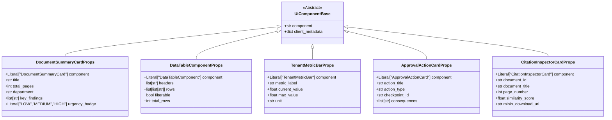
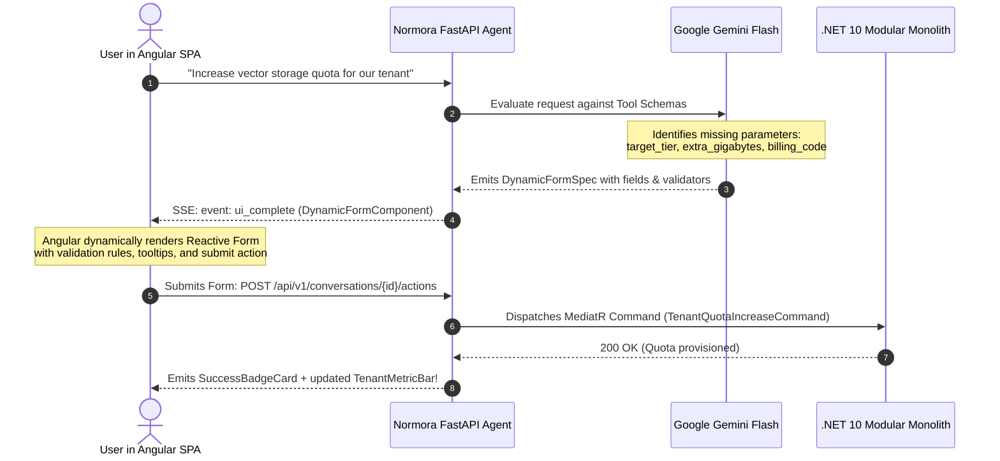
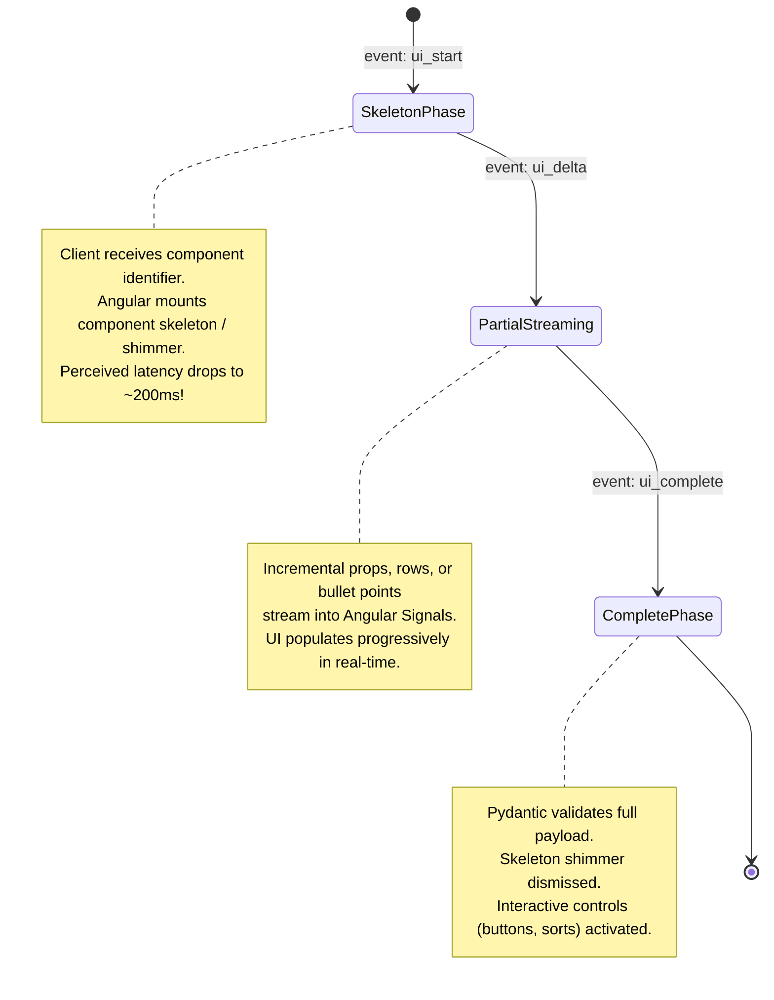
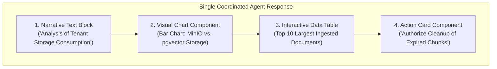
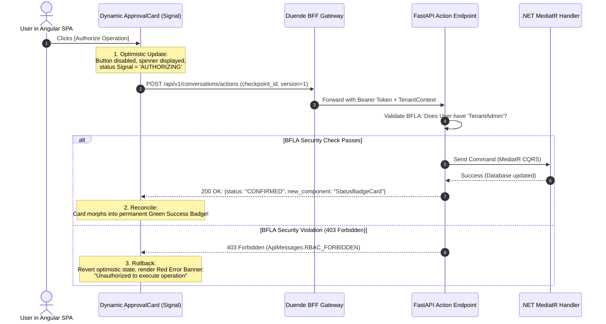
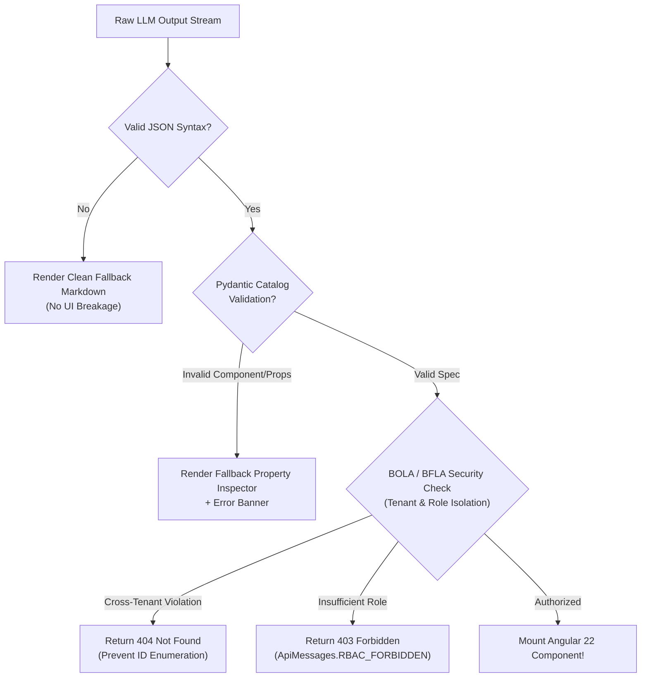
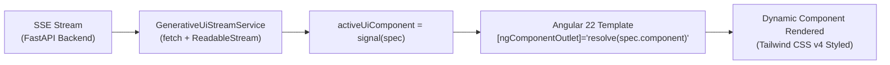

# Module 20: Agent-to-UI (A2UI) Generative Component Streaming

Welcome to **Module 20** of the Normora Python & AI Architect Masterclass.

For years, enterprise conversational interfaces were trapped inside a static markdown box. The user asked a question, and the model returned paragraphs of text, bulleted lists, and static code blocks. In an enterprise system like **Normora**—a multi-tenant knowledge management and conversational AI platform—markdown alone fails to meet the needs of knowledge workers:
* When a compliance officer asks: *"Show me all unindexed PDF documents with their storage quotas across departments,"* a wall of markdown text is frustrating to parse.
* When a tenant administrator asks: *"Upgrade our vector storage capacity and increase our LLM quota,"* a text instruction cannot securely gather parameters, collect billing confirmation, or trigger a background task.
* When a legal researcher queries a document: *"Compare chunks 14 and 15 regarding indemnification,"* a static markdown block cannot provide collapsible diffs, confidence score sliders, or deep-link citation pills that fetch original files from MinIO.

**Agent-to-UI (A2UI) / Generative UI** represents the next evolutionary leap in conversational architecture:
Instead of just streaming text tokens, the AI model (such as Google Gemini Flash or OpenAI GPT-4o) **streams structured UI component specifications** directly into the frontend. 

The frontend does not execute unvetted code generated by the model. Instead, backend and frontend share a **Component Catalog**. The backend model emits validated JSON payloads that dictate *which* pre-built, secure Angular 22 component to mount and *what* props to pass to it.

In this module, you will master the end-to-end architecture of Generative UI:
1. **Architectural Foundations**: The A2UI pattern, event-driven component streaming, and contract validation.
2. **Component Catalog Design**: Expressing polymorphic UI components using Pydantic v2 discriminated unions.
3. **Dynamic Form Generation**: Enabling autonomous agents to generate dynamic data collection forms when tool execution parameters are missing.
4. **Progressive Rendering**: Streaming lifecycle states (`skeleton` $\rightarrow$ `partial` $\rightarrow$ `complete`) to eradicate perceived latency.
5. **Multi-Modal Coordinated Responses**: Orchestrating composite streams containing text, charts, interactive data tables, and action triggers.
6. **Bidirectional State Synchronization**: Optimistic UI updates, revision tracking, idempotency tokens, and acknowledgment loops.
7. **Error Boundaries & Fallback Strategies**: Graceful degradation when the LLM outputs malformed payloads or encounters security violations (BOLA/BFLA).
8. **FastAPI Production Implementation**: High-performance Server-Sent Events (SSE) streaming with Google Gemini Flash and OpenAI GPT-4o.
9. **Frontend Consumption (Angular 22 & React)**: Binding dynamic component outlets, Angular Signals, and Tailwind CSS v4.
10. **.NET Developer Transition & Comparison**: Mapping C# / ASP.NET Core / SignalR / MediatR concepts to Python / FastAPI / SSE.

---

## 1. Architectural Overview: The Shift from Text Chatbots to Generative UI (A2UI)

### The Problem with Traditional Conversational AI
In traditional chat systems, the Large Language Model generates raw text. If you want to show a table, the model formats it in GitHub-flavored markdown. If you want to show an approval button, the model writes `[Approve](https://...)`—which lacks validation, state binding, role checks, and interactive capabilities.

```
Traditional Text Streaming:
[User Prompt] -> [LLM] -> "Here is the table:\n| Tenant | Status |\n| Acme | Active |" -> [Client Markdown Parser]
```

### The Generative UI (A2UI) Paradigm
In Generative UI, the LLM is treated as an **intelligent UI orchestrator**. Given a user query and conversation context, the agent decides *how* best to present the response. It can reply with plain text, an interactive card, an analytical chart, a dynamic parameter form, or a composite layout combining all of them.

```mermaid
flowchart TD
    User["Angular 22 Client<br>(Signals + Tailwind CSS v4)"] -->|POST /api/v1/conversations/{id}/stream-ui| Gateway["Duende BFF / FastAPI Gateway"]
    Gateway -->|Keycloak JWT + TenantContext| Agent["Normora Orchestration Agent<br>(FastAPI Async Engine)"]
    Agent -->|RAG Retrieval| VectorDB[("PostgreSQL + pgvector<br>HNSW Cosine Chunks")]
    Agent -->|Structured Output Schema| CloudLLM["Cloud AI Engine<br>(Google Gemini Flash / GPT-4o)"]
    CloudLLM -->|Streamed Component Spec JSON| Validator["Pydantic v2 Discriminated<br>Union Validator"]
    Validator -->|Validated UI Events| SSE["Server-Sent Events (SSE) Stream<br>(event: ui_start, ui_delta, ui_complete)"]
    SSE -->|Progressive Rendering| User
    User -->|Interactive Action Callback<br>POST /api/v1/conversations/{id}/actions| ActionHandler["FastAPI CQRS Action Handler"]
    ActionHandler -->|MediatR Cross-Module Contract| Backend["Normora Backend (.NET 10 / DB)"]
```

### Python Fundamentals Primer for the .NET Developer
Before diving into code, let us map foundational Python concepts to their C# equivalents:

| Python Concept | C# / .NET Equivalent | Description |
| :--- | :--- | :--- |
| `async def` / `await` | `async Task` / `await` | Asynchronous coroutine definition and execution. |
| `yield` in `async def` | `yield return` in `IAsyncEnumerable<T>` | Asynchronous streaming generator yielding items one at a time. |
| `Pydantic BaseModel` | `record` or `class` with attributes | Strongly-typed data contract with automatic runtime validation and serialization. |
| `Literal["A", "B"]` | `enum` or string constants | Constrains a field value to exact string literals. |
| `Annotated[Union[...], Field(discriminator="type")]` | `[JsonPolymorphic(TypeDiscriminatorPropertyName = "type")]` | Polymorphic serialization based on a specific JSON property tag. |
| `dict[str, Any]` | `Dictionary<string, object>` | Key-value dictionary with arbitrary typed values. |
| `str \| None` | `string?` | Nullable reference type (union with `None`). |
| `snake_case` | `PascalCase` / `camelCase` | Standard Python naming convention for variables, functions, and methods. |

> [!NOTE]
> In Python, typing is validated at **runtime** by libraries like Pydantic, rather than at compile-time by the compiler. When streaming data from an LLM, Pydantic guarantees that malformed JSON is caught and rejected *before* reaching the frontend.

---

### 5 Real-World Normora Examples: Why Generative UI Outperforms Text

#### Example 1.1: Tenant Tier Upgrade Recommendation Card
When a tenant administrator inquires why their daily indexing jobs are being throttled, the agent inspects the PostgreSQL database, observes that vector storage is at 98% capacity, and emits an interactive `TenantUpgradeCard`:

```python
# Demonstrating the conceptual payload emitted by the agent:
tenant_upgrade_card_spec = {
    "component": "TenantUpgradeCard",
    "props": {
        "tenant_id": "tenant-corp-alpha",
        "current_tier": "STANDARD",
        "recommended_tier": "ENTERPRISE",
        "current_vector_count": 98_500,
        "max_vector_limit": 100_000,
        "price_delta_monthly_usd": 250.00,
        "benefits": [
            "HNSW vector index partition isolation",
            "Unlimited MinIO document storage",
            "Dedicated background worker queue for chunk embeddings"
        ],
        "upgrade_checkpoint_id": "chkpt-upgrade-9921"
    }
}
```

#### Example 1.2: Document Vector Ingestion Health Gauge
Instead of printing: *"Your document HR_Policy_2026.pdf was split into 85 chunks and indexed with an average cosine distance of 0.12,"* the agent generates a live `VectorHealthGaugeComponent` displaying index health, chunking density, and embedding latency:

```python
vector_health_spec = {
    "component": "VectorHealthGauge",
    "props": {
        "document_id": "doc-8812-hr-policy",
        "document_name": "HR_Policy_2026.pdf",
        "total_chunks": 85,
        "embedding_model": "text-embedding-004",
        "index_type": "pgvector_hnsw",
        "average_similarity_score": 0.88,
        "quarantined_chunks": 0,
        "status": "HEALTHY"
    }
}
```

#### Example 1.3: RAG Semantic Chunk Comparison Inspector
When a legal analyst asks how two conflicting indemnity clauses differ across vendor contracts, the agent returns an interactive `ChunkDiffInspectorComponent` with side-by-side diff highlighting, token overlap calculations, and citation badges:

```python
chunk_diff_spec = {
    "component": "ChunkDiffInspector",
    "props": {
        "source_a": {
            "document_title": "Master_Services_Agreement_2024.pdf",
            "chunk_index": 14,
            "page_number": 6,
            "text": "Vendor liability shall not exceed the total fees paid during the prior 12 months."
        },
        "source_b": {
            "document_title": "Master_Services_Agreement_2026_Revised.pdf",
            "chunk_index": 19,
            "page_number": 8,
            "text": "Vendor liability for data breach indemnification shall be uncapped and perpetual."
        },
        "semantic_similarity": 0.64,
        "discrepancy_category": "LIABILITY_CAP_REMOVAL"
    }
}
```

#### Example 1.4: RBAC Role Elevation Request Modal
When a team member attempts to access confidential M&A documents, the conversational agent verifies that the user lacks the `MergersAndAcquisitionsSpecialist` role, but instead of a dead-end 403 error, it renders an interactive `RoleElevationModal`:

```python
role_elevation_spec = {
    "component": "RoleElevationModal",
    "props": {
        "requested_role": "DepartmentSpecialist_Mergers",
        "target_document_id": "doc-confidential-ma-2026",
        "tenant_id": "tenant-corp-alpha",
        "requires_manager_approval": True,
        "urgency_options": ["STANDARD", "CRITICAL_COMPLIANCE"],
        "action_endpoint": "/api/v1/tenants/rbac/request-elevation"
    }
}
```

#### Example 1.5: Multi-Document Cross-Citation Matrix
When a user asks: *"Which company policies mandate multi-factor authentication (MFA)?"* the agent renders an interactive `CitationMatrixComponent` cross-referencing findings across IT, HR, and Security repositories:

```python
citation_matrix_spec = {
    "component": "CitationMatrix",
    "props": {
        "query_topic": "Multi-Factor Authentication (MFA) Requirements",
        "citations": [
            {
                "document_title": "IT_Security_Baseline_v4.pdf",
                "department": "Information Security",
                "clause": "Section 4.2 - MFA on all corporate single sign-on portals",
                "enforcement_date": "2025-01-01"
            },
            {
                "document_title": "Remote_Work_Guidelines.pdf",
                "department": "Human Resources",
                "clause": "Section 2.1 - Authenticator app required for home VPN access",
                "enforcement_date": "2025-06-15"
            }
        ]
    }
}
```

---

## 2. Defining the Component Catalog with Strict Pydantic Contracts

In C#, if you want to stream polymorphic UI components, you might create an abstract base class `UiComponent` with derived classes (`SummaryCardComponent`, `DataTableComponent`), annotated with `[JsonPolymorphic(TypeDiscriminatorPropertyName = "component")]`.

In Python, we achieve identical compile-and-runtime safety using **Pydantic v2 Discriminated Unions** with `typing.Literal` and `typing.Annotated`.



### 5 Real-World Normora Component Contracts

Here are the complete, production-grade Pydantic contracts used across Normora's knowledge platform:

#### Example 2.1: The `DocumentSummaryCardProps` Contract
```python
from typing import Literal
from pydantic import BaseModel, Field

class DocumentSummaryCardProps(BaseModel):
    """
    Renders an executive summary card for an ingested document in Normora.
    """
    component: Literal["DocumentSummaryCard"] = "DocumentSummaryCard"
    title: str = Field(..., description="Document file name or clean title")
    total_pages: int = Field(gt=0, description="Total page count of the PDF")
    department: str = Field(..., description="Owner department (e.g. Legal, HR, Finance)")
    key_findings: list[str] = Field(
        ...,
        min_length=1,
        max_length=6,
        description="Bulleted highlights extracted by the RAG model"
    )
    urgency_badge: Literal["LOW", "MEDIUM", "HIGH"] = Field(
        default="LOW",
        description="Urgency flag based on compliance risks"
    )
    minio_storage_path: str = Field(
        ...,
        description="Internal S3/MinIO key for secure document download"
    )

# Instantiating and validating a real Normora document summary card:
summary_card = DocumentSummaryCardProps(
    title="Employee_Benefits_and_Healthcare_2026.pdf",
    total_pages=38,
    department="Human Resources",
    key_findings=[
        "Comprehensive dental coverage expanded to dependents",
        "Mental health stipend increased to $1,200 annually",
        "Open enrollment deadline is November 30, 2026"
    ],
    urgency_badge="HIGH",
    minio_storage_path="tenants/corp-alpha/docs/2026/hr_benefits.pdf"
)

print(f"Validated component: <{summary_card.component}> for '{summary_card.title}'")
```

#### Example 2.2: The `DataTableComponentProps` Contract
```python
class DataTableComponentProps(BaseModel):
    """
    Renders an interactive, sortable, and filterable data table in Angular 22.
    """
    component: Literal["DataTableComponent"] = "DataTableComponent"
    table_title: str = Field(..., description="User-facing title of the table")
    headers: list[str] = Field(..., min_length=1, description="Column header labels")
    rows: list[list[str]] = Field(..., description="2D matrix of cell values")
    filterable: bool = Field(default=True, description="Enable client-side search filtering")
    total_records: int = Field(..., description="Total records matching query")

table_component = DataTableComponentProps(
    table_title="Legal Department Ingested Contracts",
    headers=["Document Title", "Contract Type", "Sign Date", "Vector Chunks", "Status"],
    rows=[
        ["Vendor_SaaS_Agreement.pdf", "Vendor", "2026-01-15", "42", "INDEXED"],
        ["Office_Lease_HQ.pdf", "Real Estate", "2025-11-01", "128", "INDEXED"],
        ["Master_NDA_Acme.pdf", "Confidentiality", "2026-02-10", "16", "INDEXED"]
    ],
    filterable=True,
    total_records=3
)
print(f"Validated table: {table_component.table_title} with {len(table_component.rows)} rows.")
```

#### Example 2.3: The `TenantMetricBarProps` Contract
```python
class TenantMetricBarProps(BaseModel):
    """
    Renders visual metric progress bars for tenant resource monitoring.
    """
    component: Literal["TenantMetricBar"] = "TenantMetricBar"
    metric_label: str = Field(..., description="Resource name being monitored")
    current_value: float = Field(ge=0.0, description="Current consumption level")
    max_value: float = Field(gt=0.0, description="Provisioned ceiling")
    unit: str = Field(..., description="Unit of measurement (e.g. MB, GB, tokens, vectors)")
    alert_threshold_percentage: float = Field(
        default=90.0,
        description="Percentage at which UI displays amber/red warning"
    )

metric_bar = TenantMetricBarProps(
    metric_label="PostgreSQL pgvector HNSW Vector Capacity",
    current_value=854_000.0,
    max_value=1_000_000.0,
    unit="vectors",
    alert_threshold_percentage=85.0
)
print(f"Metric: {metric_bar.metric_label} ({metric_bar.current_value}/{metric_bar.max_value} {metric_bar.unit})")
```

#### Example 2.4: The `ApprovalActionCardProps` Contract
```python
class ApprovalActionCardProps(BaseModel):
    """
    Renders a high-stakes confirmation card requiring explicit human approval.
    """
    component: Literal["ApprovalActionCard"] = "ApprovalActionCard"
    action_title: str = Field(..., description="Title of the destructive or billing action")
    action_type: Literal[
        "PURGE_AUDIT_LOGS",
        "DELETE_COLLECTION",
        "REINDEX_ALL_DOCUMENTS",
        "UPGRADE_TENANT_TIER"
    ] = Field(..., description="System action identifier")
    checkpoint_id: str = Field(..., description="Unique state checkpoint identifier")
    consequences: list[str] = Field(..., description="List of irreversible side effects")
    confirm_label: str = Field(default="Authorize Operation", description="Button text for approval")
    cancel_label: str = Field(default="Abort", description="Button text for rejection")

approval_card = ApprovalActionCardProps(
    action_title="Permanently Re-Index Entire Knowledge Base",
    action_type="REINDEX_ALL_DOCUMENTS",
    checkpoint_id="chkpt-reindex-8841-corp-alpha",
    consequences=[
        "All 12,400 existing pgvector HNSW chunks will be deleted",
        "Semantic search will experience degraded accuracy for ~45 minutes",
        "Estimated Gemini embedding API cost: $14.50"
    ]
)
print(f"Approval Card Generated: Checkpoint '{approval_card.checkpoint_id}'")
```

#### Example 2.5: The `CitationInspectorCardProps` and Master Polymorphic Catalog
```python
from typing import Union, Annotated

class CitationInspectorCardProps(BaseModel):
    """
    Renders an in-depth citation card with chunk text, page preview, and similarity score.
    """
    component: Literal["CitationInspectorCard"] = "CitationInspectorCard"
    document_id: str = Field(..., description="Normora document UUID")
    document_title: str = Field(..., description="File name of cited document")
    page_number: int = Field(ge=1, description="Page where chunk originates")
    chunk_index: int = Field(ge=0, description="Ordinal index of chunk")
    chunk_text: str = Field(..., description="Extracted paragraph text")
    similarity_score: float = Field(ge=0.0, le=1.0, description="Cosine similarity score")
    minio_download_url: str = Field(..., description="Pre-signed URL for PDF page preview")

# The Master Polymorphic Discriminated Union:
# Any component sent to the client must conform to one of these schemas!
UiComponentSpec = Annotated[
    Union[
        DocumentSummaryCardProps,
        DataTableComponentProps,
        TenantMetricBarProps,
        ApprovalActionCardProps,
        CitationInspectorCardProps
    ],
    Field(discriminator="component")
]

class GenerativeUiMessagePayload(BaseModel):
    """
    Envelope combining conversational text with an optional dynamic UI component.
    """
    conversation_id: str
    message_text: str | None = None
    ui_component: UiComponentSpec | None = None

# Testing validation of a polymorphic message:
test_payload = GenerativeUiMessagePayload(
    conversation_id="conv-8812-legal",
    message_text="Here is the specific citation proving compliance with SOC-2:",
    ui_component={
        "component": "CitationInspectorCard",
        "document_id": "doc-uuid-9912",
        "document_title": "SOC2_Type_II_Report_2025.pdf",
        "page_number": 42,
        "chunk_index": 7,
        "chunk_text": "All production database instances enforce encryption at rest using AES-256.",
        "similarity_score": 0.94,
        "minio_download_url": "https://minio.normora.internal/tenants/corp-alpha/previews/page42.pdf"
    }
)

# Pydantic automatically parses `ui_component` into a CitationInspectorCardProps instance!
assert isinstance(test_payload.ui_component, CitationInspectorCardProps)
print(f"Successfully validated polymorphic component of type: {type(test_payload.ui_component).__name__}")
```

---

## 3. Dynamic Form Generation from Agent Decisions

One of the most powerful aspects of Generative UI is **dynamic form generation**. In complex enterprise workflows, an AI agent often needs additional structured parameters from the user before it can invoke a backend tool.

Instead of engaging in a tedious multi-turn back-and-forth chat:
> **User**: *"I need to re-index all engineering documents."*  
> **Agent**: *"What chunk size do you want?"*  
> **User**: *"512"*  
> **Agent**: *"What overlap percentage do you want?"*  
> **User**: *"10%"*  
> **Agent**: *"What embedding model?"*  

The agent identifies the missing inputs and **generates a complete, validated dynamic form component** on the fly!



### Form Schema Contract
To support dynamic forms, we define a generic, schema-driven Pydantic contract:

```python
from typing import Literal, Any
from pydantic import BaseModel, Field

class FormFieldOption(BaseModel):
    label: str
    value: str

class FormFieldSpec(BaseModel):
    field_id: str = Field(..., description="Unique property key for this field")
    label: str = Field(..., description="Display label in the form UI")
    field_type: Literal["text", "number", "select", "date", "boolean", "textarea"]
    placeholder: str = ""
    default_value: Any = None
    required: bool = True
    min_value: float | None = None
    max_value: float | None = None
    options: list[FormFieldOption] | None = None  # Populated for "select" type
    help_text: str | None = None

class DynamicFormComponentProps(BaseModel):
    component: Literal["DynamicFormComponent"] = "DynamicFormComponent"
    form_id: str = Field(..., description="Unique tracking identifier for form instance")
    title: str
    description: str
    submit_button_label: str = "Submit Request"
    submit_endpoint: str = "/api/v1/conversations/actions/form-submit"
    fields: list[FormFieldSpec]
```

### 5 Real-World Normora Dynamic Form Examples

#### Example 3.1: Tenant Storage Quota Increase Request Form
Generated when an administrator asks to scale their tenant's storage:

```python
tenant_quota_form = DynamicFormComponentProps(
    form_id="form-quota-inc-2026",
    title="Request Tenant Storage Expansion",
    description="Your current MinIO object storage is at 94% capacity. Configure requested limits below.",
    submit_button_label="Submit Quota Request",
    fields=[
        FormFieldSpec(
            field_id="resource_type",
            label="Resource Category",
            field_type="select",
            options=[
                FormFieldOption(label="MinIO Object Storage (Raw PDFs)", value="MINIO_STORAGE"),
                FormFieldOption(label="PostgreSQL pgvector (HNSW Vectors)", value="PGVECTOR_STORAGE"),
                FormFieldOption(label="Daily Gemini LLM Tokens", value="LLM_TOKENS")
            ],
            default_value="MINIO_STORAGE"
        ),
        FormFieldSpec(
            field_id="requested_increase_gb",
            label="Additional Capacity (GB)",
            field_type="number",
            min_value=50.0,
            max_value=2000.0,
            default_value=250.0,
            help_text="Standard expansion increments are 50 GB."
        ),
        FormFieldSpec(
            field_id="cost_center_code",
            label="Internal Cost Center / Billing Code",
            field_type="text",
            placeholder="CC-LEGAL-2026-Q1",
            required=True
        )
    ]
)
print(f"Generated form: {tenant_quota_form.title} with {len(tenant_quota_form.fields)} fields.")
```

#### Example 3.2: Document Re-Indexing & Chunking Strategy Configuration Form
Generated when a knowledge manager requests re-chunking of a departmental collection:

```python
chunking_config_form = DynamicFormComponentProps(
    form_id="form-chunking-opt-881",
    title="Configure RAG Chunking Parameters",
    description="Adjusting chunk sizes affects semantic search granularity and LLM context window utilization.",
    submit_button_label="Execute Re-Indexing Pipeline",
    fields=[
        FormFieldSpec(
            field_id="chunk_size_tokens",
            label="Chunk Size (Tokens)",
            field_type="number",
            min_value=128.0,
            max_value=2048.0,
            default_value=512.0,
            help_text="Recommended for PDF policies: 512 tokens."
        ),
        FormFieldSpec(
            field_id="chunk_overlap_percentage",
            label="Chunk Overlap (%)",
            field_type="number",
            min_value=0.0,
            max_value=30.0,
            default_value=15.0,
            help_text="Prevents loss of context across sentence boundaries."
        ),
        FormFieldSpec(
            field_id="embedding_model",
            label="Embedding Model",
            field_type="select",
            options=[
                FormFieldOption(label="Google Text-Embedding-004 (768-dim)", value="text-embedding-004"),
                FormFieldOption(label="OpenAI Text-Embedding-3-Large (1536-dim)", value="text-embedding-3-large")
            ],
            default_value="text-embedding-004"
        ),
        FormFieldSpec(
            field_id="rebuild_hnsw_index",
            label="Rebuild HNSW Index Concurrently",
            field_type="boolean",
            default_value=True,
            help_text="Guarantees zero-downtime search queries during re-indexing."
        )
    ]
)
```

#### Example 3.3: Citation Dispute / Hallucination Report Form
Generated when a user flags an AI answer as potentially inaccurate:

```python
dispute_form = DynamicFormComponentProps(
    form_id="form-dispute-hallucination-992",
    title="Report Inaccurate RAG Citation",
    description="Submit feedback to help refine Normora's retrieval reranker and audit ground-truth compliance.",
    submit_button_label="Submit Audit Ticket",
    fields=[
        FormFieldSpec(
            field_id="citation_id",
            label="Disputed Citation Chunk ID",
            field_type="text",
            default_value="chunk-99182-page-14",
            required=True
        ),
        FormFieldSpec(
            field_id="dispute_reason",
            label="Nature of Inaccuracy",
            field_type="select",
            options=[
                FormFieldOption(label="Factual Contradiction with Source Document", value="CONTRADICTION"),
                FormFieldOption(label="Outdated Policy Version Cited", value="OUTDATED_VERSION"),
                FormFieldOption(label="Misattributed Department Ownership", value="MISATTRIBUTION"),
                FormFieldOption(label="Hallucinated Entity or Number", value="HALLUCINATION")
            ]
        ),
        FormFieldSpec(
            field_id="user_explanation",
            label="Detailed Explanation & Correct Reference",
            field_type="textarea",
            placeholder="Explain why this citation is incorrect and reference the correct document if known...",
            required=True
        )
    ]
)
```

#### Example 3.4: Bulk User Invitation & RBAC Assignment Form
Generated when a tenant admin asks: *"I need to onboard the 5 new members of the corporate compliance team."*

```python
bulk_invite_form = DynamicFormComponentProps(
    form_id="form-bulk-invite-rbac-441",
    title="Invite Team Members & Assign Roles",
    description="Invited members will receive an email to authenticate via Keycloak SSO.",
    submit_button_label="Send Keycloak Invitations",
    fields=[
        FormFieldSpec(
            field_id="email_addresses",
            label="Corporate Email Addresses (comma-separated)",
            field_type="textarea",
            placeholder="sarah.connor@normora.com, john.smith@normora.com",
            required=True
        ),
        FormFieldSpec(
            field_id="assigned_role",
            label="Assigned RBAC Role",
            field_type="select",
            options=[
                FormFieldOption(label="Reader (Query & View Citations Only)", value="TenantReader"),
                FormFieldOption(label="Knowledge Contributor (Upload & Edit Docs)", value="TenantContributor"),
                FormFieldOption(label="Compliance Auditor (Full Access + Audit Logs)", value="TenantComplianceAuditor")
            ],
            default_value="TenantReader"
        ),
        FormFieldSpec(
            field_id="department_tag",
            label="Department Affiliation",
            field_type="text",
            placeholder="Corporate Compliance & Risk",
            required=True
        )
    ]
)
```

#### Example 3.5: RAG Semantic Retrieval Filter Refinement Form
Generated when a query is ambiguous across departments:

```python
search_filter_form = DynamicFormComponentProps(
    form_id="form-search-filter-refine-102",
    title="Refine Document Search Scope",
    description="Your query matches documents in 4 different departments. Narrow the scope for higher precision.",
    submit_button_label="Apply Filters & Re-run Query",
    fields=[
        FormFieldSpec(
            field_id="target_department",
            label="Target Department",
            field_type="select",
            options=[
                FormFieldOption(label="All Accessible Departments", value="ALL"),
                FormFieldOption(label="Legal & Contracts Only", value="LEGAL"),
                FormFieldOption(label="Human Resources & Benefits", value="HR"),
                FormFieldOption(label="Engineering & Security Architecture", value="ENG")
            ],
            default_value="ALL"
        ),
        FormFieldSpec(
            field_id="document_recency_cutoff",
            label="Document Ingestion Date",
            field_type="date",
            default_value="2025-01-01",
            help_text="Ignore documents published prior to this date."
        ),
        FormFieldSpec(
            field_id="min_similarity_threshold",
            label="Cosine Similarity Cutoff (0.50 to 0.95)",
            field_type="number",
            min_value=0.50,
            max_value=0.95,
            default_value=0.75,
            help_text="Higher values return only exact semantic matches."
        )
    ]
)
```

---

## 4. Progressive Rendering: Skeleton $\rightarrow$ Partial $\rightarrow$ Complete

When an LLM generates a large JSON payload (for example, a 50-row data table or an in-depth document report), the user might have to wait 4 to 6 seconds if the system waits for the complete JSON to finish generating before rendering. This creates a terrible user experience.

On the other hand, if you parse incomplete JSON naively, `json.loads()` will throw a `JSONDecodeError` because the closing brackets and quotes are missing.

### The Progressive Lifecycle Solution
Normora solves this using a **three-phase streaming lifecycle**:



### Event Stream Format (SSE)
```
event: ui_start
data: {"component": "DocumentSummaryCard", "layout": "full_card"}

event: ui_delta
data: {"field": "title", "value": "Vendor_Contract_2026.pdf"}

event: ui_delta
data: {"field": "key_findings", "append_item": "Indemnification capped at $5M"}

event: ui_complete
data: {"component": "DocumentSummaryCard", "props": { ...complete validated JSON... }}
```

### 5 Real-World Normora Progressive Streaming Examples

#### Example 4.1: Progressive Document Ingestion Pipeline Status Card
When a user uploads a 500-page compliance manual, the agent displays a multi-stage pipeline card that updates each step in real time:

```python
import asyncio
import json
from typing import AsyncGenerator

async def stream_ingestion_pipeline_progress(document_id: str) -> AsyncGenerator[str, None]:
    # 1. Mount Skeleton
    yield "event: ui_start\ndata: {\"component\": \"IngestionPipelineCard\", \"document_id\": \"" + document_id + "\"}\n\n"
    await asyncio.sleep(0.05)

    stages = [
        {"stage": "PARSING_PDF", "progress": 100, "status": "COMPLETED", "detail": "Extracted 512 pages from MinIO"},
        {"stage": "CHUNKING", "progress": 100, "status": "COMPLETED", "detail": "Generated 1,240 semantic chunks"},
        {"stage": "EMBEDDING", "progress": 65, "status": "IN_PROGRESS", "detail": "Vectorizing with text-embedding-004..."},
        {"stage": "HNSW_INDEXING", "progress": 0, "status": "PENDING", "detail": "Queued for pgvector"}
    ]

    for stage_info in stages:
        await asyncio.sleep(0.1)
        yield f"event: ui_delta\ndata: {json.dumps(stage_info)}\n\n"

    # Finalize
    final_props = {
        "component": "IngestionPipelineCard",
        "document_id": document_id,
        "is_complete": False,
        "active_stage": "EMBEDDING",
        "estimated_remaining_seconds": 12
    }
    yield f"event: ui_complete\ndata: {json.dumps(final_props)}\n\n"
```

#### Example 4.2: Incremental Data Table Row-by-Row Streaming
Stream large audit records row-by-row as database queries resolve, without freezing the client:

```python
async def stream_audit_table_rows(tenant_id: str) -> AsyncGenerator[str, None]:
    # Phase 1: Mount table skeleton with headers
    yield (
        "event: ui_start\n"
        "data: {\"component\": \"DataTableComponent\", \"table_title\": \"Security Audit Stream\", "
        "\"headers\": [\"Timestamp\", \"User\", \"Action\", \"Severity\"]}\n\n"
    )

    # Simulated streaming of rows from PostgreSQL:
    sample_audit_rows = [
        ["2026-02-18T14:02:11Z", "admin@normora.internal", "EXPORT_TENANT_METRICS", "INFO"],
        ["2026-02-18T14:05:44Z", "j.doe@corp.com", "FAILED_DOCUMENT_ACCESS", "WARNING"],
        ["2026-02-18T14:10:02Z", "service-worker-4", "PGVECTOR_INDEX_REBUILD", "INFO"]
    ]

    for row in sample_audit_rows:
        await asyncio.sleep(0.08)
        yield f"event: ui_delta\ndata: {json.dumps({'append_row': row})}\n\n"

    # Phase 3: Complete payload
    yield (
        "event: ui_complete\n"
        "data: {\"component\": \"DataTableComponent\", \"total_rows\": 3, \"filterable\": True}\n\n"
    )
```

#### Example 4.3: Document Executive Summary with Streaming Bullet Points
Stream key takeaways one by one as Google Gemini Flash outputs them:

```python
async def stream_summary_bullet_points() -> AsyncGenerator[str, None]:
    yield "event: ui_start\ndata: {\"component\": \"DocumentSummaryCard\", \"title\": \"Cyber_Insurance_Policy.pdf\"}\n\n"

    bullet_points = [
        "Ransomware extortion coverage capped at $2,500,000.",
        "Forensic incident investigation requires pre-approved panel vendors.",
        "MFA must be enforced on all administrative endpoints to maintain valid coverage."
    ]

    for bullet in bullet_points:
        await asyncio.sleep(0.1)
        yield f"event: ui_delta\ndata: {json.dumps({'field': 'key_findings', 'append_item': bullet})}\n\n"

    yield (
        "event: ui_complete\n"
        "data: {\"component\": \"DocumentSummaryCard\", \"urgency_badge\": \"HIGH\", \"department\": \"Legal\"}\n\n"
    )
```

#### Example 4.4: Comparative RAG Benchmark Chart with Streaming Data Series
Progressively render benchmark telemetry comparing Gemini Flash vs. GPT-4o retrieval latency:

```python
async def stream_benchmark_chart() -> AsyncGenerator[str, None]:
    yield "event: ui_start\ndata: {\"component\": \"BenchmarkChart\", \"chart_type\": \"bar\", \"title\": \"RAG Query Latency\"}\n\n"

    data_points = [
        {"model": "Gemini 1.5 Flash (Cold)", "latency_ms": 380, "cost_cents": 0.04},
        {"model": "Gemini 1.5 Flash (Cached)", "latency_ms": 95, "cost_cents": 0.01},
        {"model": "GPT-4o (Cold)", "latency_ms": 620, "cost_cents": 0.18}
    ]

    for point in data_points:
        await asyncio.sleep(0.06)
        yield f"event: ui_delta\ndata: {json.dumps({'append_series': point})}\n\n"

    yield "event: ui_complete\ndata: {\"component\": \"BenchmarkChart\", \"status\": \"READY\"}\n\n"
```

#### Example 4.5: Tenant Security Audit Log Stream with Live Timeline Nodes
Stream chronological security events into a vertical timeline component:

```python
async def stream_security_timeline() -> AsyncGenerator[str, None]:
    yield "event: ui_start\ndata: {\"component\": \"SecurityTimeline\", \"tenant_id\": \"corp-alpha\"}\n\n"

    events = [
        {"time": "10:00 AM", "event": "Keycloak OIDC login successful from IP 192.168.1.50"},
        {"time": "10:14 AM", "event": "Document 'Q4_Financials.pdf' retrieved via Duende BFF"},
        {"time": "10:30 AM", "event": "BFLA Check passed: Role 'TenantAdmin' authorized"}
    ]

    for ev in events:
        await asyncio.sleep(0.05)
        yield f"event: ui_delta\ndata: {json.dumps({'append_event': ev})}\n\n"

    yield "event: ui_complete\ndata: {\"component\": \"SecurityTimeline\", \"total_events\": 3}\n\n"
```

---

## 5. Multi-Modal Responses: Coordinated Text + Charts + Tables + Actions

In real enterprise systems, an AI response rarely consists of just one element. A high-value answer typically requires a **composite multi-modal payload**:
1. **Conversational Text**: High-level explanation of the findings.
2. **Chart/Visualization**: High-level visual trends or distributions.
3. **Structured Data Table**: Granular line-item breakdown for verification.
4. **Action Card / Button**: Clear next steps or remediation triggers.



### Pydantic Contract for Composite Responses

```python
from typing import Literal, Union, Annotated
from pydantic import BaseModel, Field

class TextBlock(BaseModel):
    block_type: Literal["text"] = "text"
    content: str

class ChartBlock(BaseModel):
    block_type: Literal["chart"] = "chart"
    chart_type: Literal["bar", "line", "pie", "donut"]
    title: str
    labels: list[str]
    datasets: list[dict[str, Any]]

class TableBlock(BaseModel):
    block_type: Literal["table"] = "table"
    title: str
    headers: list[str]
    rows: list[list[str]]

class ActionBlock(BaseModel):
    block_type: Literal["action"] = "action"
    action_title: str
    action_type: str
    checkpoint_id: str
    confirm_label: str

ResponseBlock = Annotated[
    Union[TextBlock, ChartBlock, TableBlock, ActionBlock],
    Field(discriminator="block_type")
]

class CompositeAgentResponse(BaseModel):
    conversation_id: str
    blocks: list[ResponseBlock]
```

### 5 Real-World Normora Multi-Modal Response Examples

#### Example 5.1: Tenant Storage & Vector Cost Analysis Response
```python
cost_analysis_response = CompositeAgentResponse(
    conversation_id="conv-mgmt-991",
    blocks=[
        TextBlock(
            content=(
                "Your tenant storage utilization has surged by 42% over the last 30 days, "
                "primarily driven by uncompressed PDF scans uploaded to the Legal collection."
            )
        ),
        ChartBlock(
            chart_type="bar",
            title="Monthly Storage Breakdown (Gigabytes)",
            labels=["MinIO PDFs", "pgvector Embeddings", "PostgreSQL Metadata"],
            datasets=[{"data": [450, 120, 35], "color": "#0284c7"}]
        ),
        TableBlock(
            title="Top 3 Storage Consuming Documents",
            headers=["Document File Name", "Size (MB)", "Chunk Count", "Uploaded By"],
            rows=[
                ["Litigation_Discovery_Batch_A.pdf", "340 MB", "4,200", "e.edwards@normora.internal"],
                ["M_and_A_Due_Diligence_Archive.pdf", "185 MB", "2,150", "c.law@normora.internal"],
                ["Employee_Directory_Historical.pdf", "45 MB", "520", "hr.admin@normora.internal"]
            ]
        ),
        ActionBlock(
            action_title="Compress and Archive Inactive Chunks to Cold Storage",
            action_type="ARCHIVE_INACTIVE_CHUNKS",
            checkpoint_id="chkpt-archive-7712",
            confirm_label="Approve Archival (Saves ~$85/mo)"
        )
    ]
)
print(f"Constructed composite response with {len(cost_analysis_response.blocks)} multi-modal blocks.")
```

#### Example 5.2: RAG Retrieval Latency & Hallucination Diagnostic Response
When a developer diagnoses slow queries in the conversational assistant:

```python
diagnostic_response = CompositeAgentResponse(
    conversation_id="conv-diag-102",
    blocks=[
        TextBlock(
            content="RAG pipeline execution took 1,420ms. The bottleneck was pgvector HNSW index probing due to a high `ef_search` configuration."
        ),
        ChartBlock(
            chart_type="donut",
            title="Execution Latency Breakdown (ms)",
            labels=["Embed Query (Gemini)", "Vector Search (pgvector)", "Reranking", "LLM Generation"],
            datasets=[{"data": [110, 890, 85, 335]}]
        ),
        TableBlock(
            title="Retrieved Chunks Evaluation",
            headers=["Chunk UUID", "Page", "Cosine Similarity", "Rerank Score"],
            rows=[
                ["chunk-991", "12", "0.89", "0.96"],
                ["chunk-992", "14", "0.84", "0.91"],
                ["chunk-993", "28", "0.62", "0.38"]
            ]
        ),
        ActionBlock(
            action_title="Tune HNSW ef_search from 128 to 64",
            action_type="OPTIMIZE_HNSW_PARAMS",
            checkpoint_id="chkpt-hnsw-tune-441",
            confirm_label="Apply Index Optimization"
        )
    ]
)
```

#### Example 5.3: Document Compliance & PII Scan Audit Report
When an compliance officer runs a privacy scan across newly uploaded documents:

```python
pii_scan_response = CompositeAgentResponse(
    conversation_id="conv-compliance-004",
    blocks=[
        TextBlock(
            content="Automated PII scan identified 14 potential Social Security Number (SSN) patterns in newly ingested onboarding forms."
        ),
        ChartBlock(
            chart_type="pie",
            title="Identified PII Categories",
            labels=["SSN", "Credit Card Numbers", "Personal Phone Numbers"],
            datasets=[{"data": [14, 2, 8]}]
        ),
        TableBlock(
            title="Flagged Document Chunks",
            headers=["Document Title", "Page", "Entity Type", "Redaction Status"],
            rows=[
                ["Direct_Deposit_Form_Smith.pdf", "1", "US_SSN", "PENDING_REDACTION"],
                ["W4_Tax_Withholding_2026.pdf", "2", "US_SSN", "PENDING_REDACTION"]
            ]
        ),
        ActionBlock(
            action_title="Apply Automated Redaction Mask to Flagged Vectors",
            action_type="EXECUTE_VECTOR_REDACTION",
            checkpoint_id="chkpt-redact-8819",
            confirm_label="Redact Sensitive Vectors Immediately"
        )
    ]
)
```

#### Example 5.4: Cross-Department Knowledge Coverage Audit
```python
coverage_audit_response = CompositeAgentResponse(
    conversation_id="conv-audit-771",
    blocks=[
        TextBlock(
            content="Knowledge repository coverage analysis indicates that the IT and Engineering departments maintain 95% document indexing coverage, while Finance is at 41%."
        ),
        ChartBlock(
            chart_type="bar",
            title="Departmental Indexing Coverage (%)",
            labels=["Engineering", "IT Security", "Human Resources", "Finance", "Legal"],
            datasets=[{"data": [98, 92, 88, 41, 78]}]
        ),
        TableBlock(
            title="Missing Mandatory Finance Policies",
            headers=["Policy Name", "Required By", "Status"],
            rows=[
                ["Q4_2025_Audited_Financials.pdf", "SOX Compliance", "NOT_FOUND"],
                ["Vendor_Disbursement_Controls.pdf", "Internal Audit", "OUTDATED"]
            ]
        ),
        ActionBlock(
            action_title="Dispatch Automated Ingestion Reminders to Department Heads",
            action_type="SEND_INGESTION_REMINDERS",
            checkpoint_id="chkpt-remind-finance-02",
            confirm_label="Send Notification Emails"
        )
    ]
)
```

#### Example 5.5: Semantic Search Evaluation & User Feedback Prompt
```python
search_eval_response = CompositeAgentResponse(
    conversation_id="conv-eval-221",
    blocks=[
        TextBlock(
            content="The query 'parental leave duration' matched 3 policy clauses across HR handbooks."
        ),
        TableBlock(
            title="Extracted Policy Provisions",
            headers=["Source Document", "Page", "Provision", "Applicable Jurisdiction"],
            rows=[
                ["Global_HR_Manual.pdf", "44", "16 weeks fully paid leave", "United States"],
                ["UK_Employee_Addendum.pdf", "12", "26 weeks statutory leave", "United Kingdom"]
            ]
        ),
        ActionBlock(
            action_title="Rate Response Accuracy & Helpfulness",
            action_type="SUBMIT_SEARCH_FEEDBACK",
            checkpoint_id="chkpt-feedback-5512",
            confirm_label="Mark as Accurate & Helpful"
        )
    ]
)
```

---

## 6. State Synchronization Between Agent and UI

When a user interacts with a Generative UI card (for example, clicking *"Authorize Operation"* or sliding a threshold bar), the UI must update **immediately** without waiting for round-trip latency, while maintaining strict consistency with backend authorization.

### Key Synchronization Mechanics
1. **Optimistic Updates**: The client's Angular Signal updates the component state locally (e.g. morphing the button into a spinning progress badge).
2. **Revision Tracking & Idempotency Tokens**: Every UI action carries a `checkpoint_id` and a monotonically increasing `version_id`. If an action is retried due to network jitter, the backend detects duplicate execution and returns the cached outcome.
3. **Reconciliation & Rollback**: If the backend action fails (e.g., Keycloak session expired or BFLA security check rejected), the backend returns a rollback event, causing the client to revert the optimistic state.



### 5 Real-World Normora State Synchronization Examples

#### Example 6.1: Optimistic Checkpoint Approval with Rollback on BFLA Violation
```python
from pydantic import BaseModel, Field
from typing import Literal

class UiActionRequest(BaseModel):
    checkpoint_id: str
    action_type: str
    idempotency_token: str
    client_version: int = 1
    user_decision: Literal["CONFIRM", "DECLINE"]

class UiActionResponse(BaseModel):
    success: bool
    checkpoint_id: str
    reconciled_status: Literal["EXECUTED", "REJECTED", "ROLLED_BACK"]
    updated_ui_component: dict | None = None
    error_message: str | None = None

def execute_reconciled_action(
    request: UiActionRequest,
    user_roles: list[str]
) -> UiActionResponse:
    # Enforce Broken Function Level Authorization (BFLA):
    if "TenantAdmin" not in user_roles and request.action_type == "DELETE_COLLECTION":
        return UiActionResponse(
            success=False,
            checkpoint_id=request.checkpoint_id,
            reconciled_status="ROLLED_BACK",
            error_message="Access Denied: Deleting collections requires the 'TenantAdmin' role."
        )

    # Success: return updated status card
    return UiActionResponse(
        success=True,
        checkpoint_id=request.checkpoint_id,
        reconciled_status="EXECUTED",
        updated_ui_component={
            "component": "StatusBadgeCard",
            "props": {
                "status": "SUCCESS",
                "message": f"Operation '{request.action_type}' was successfully executed."
            }
        }
    )

# Simulating an unauthorized attempt:
unauthorized_result = execute_reconciled_action(
    request=UiActionRequest(
        checkpoint_id="chkpt-del-991",
        action_type="DELETE_COLLECTION",
        idempotency_token="idem-tok-4412",
        user_decision="CONFIRM"
    ),
    user_roles=["TenantReader"]
)
print(f"Reconciliation outcome: {unauthorized_result.reconciled_status} | Reason: {unauthorized_result.error_message}")
```

#### Example 6.2: Real-Time Document Re-chunking Slider with Server-Side Recalculation
When a user drags a chunk size slider from 512 to 1024, the UI updates optimistically while debouncing a query to calculate estimated pgvector storage impact:

```python
class SliderStateSyncRequest(BaseModel):
    document_id: str
    new_chunk_size: int = Field(ge=128, le=2048)

class SliderStateSyncResponse(BaseModel):
    document_id: str
    new_chunk_size: int
    projected_total_chunks: int
    projected_storage_mb: float

def sync_slider_state(req: SliderStateSyncRequest, total_raw_characters: int) -> SliderStateSyncResponse:
    # Approximately 4 characters per token:
    estimated_tokens = total_raw_characters // 4
    projected_chunks = max(1, estimated_tokens // req.new_chunk_size)
    # 768 float32 dimensions = 3KB per vector + HNSW overhead (~4.5KB total per vector):
    projected_storage_mb = (projected_chunks * 4.5) / 1024.0

    return SliderStateSyncResponse(
        document_id=req.document_id,
        new_chunk_size=req.new_chunk_size,
        projected_total_chunks=projected_chunks,
        projected_storage_mb=round(projected_storage_mb, 2)
    )

slider_sync = sync_slider_state(
    SliderStateSyncRequest(document_id="doc-991", new_chunk_size=1024),
    total_raw_characters=500_000
)
print(f"Synced Slider: {slider_sync.new_chunk_size} tokens -> {slider_sync.projected_total_chunks} chunks ({slider_sync.projected_storage_mb} MB)")
```

#### Example 6.3: Multi-Tab Conversation Session State Synchronization
Ensure multiple browser tabs viewing the same conversation remain synchronized via SSE state broadcasts:

```python
class SessionStateBroadcast(BaseModel):
    conversation_id: str
    active_component_id: str
    current_step: Literal["AWAITING_INPUT", "STREAMING", "COMPLETED"]
    last_action_timestamp_utc: str

broadcast_event = SessionStateBroadcast(
    conversation_id="conv-shared-441",
    active_component_id="ApprovalActionCard-8812",
    current_step="AWAITING_INPUT",
    last_action_timestamp_utc="2026-02-18T14:22:00Z"
)
```

#### Example 6.4: Tenant White-Label Custom Branding State Sync
Synchronize primary brand colors, border radius, and logo assets across all generative cards:

```python
class TenantBrandingState(BaseModel):
    tenant_id: str
    primary_color_hex: str
    border_radius_rem: float
    dark_mode_enabled: bool

def inject_branding_into_component(component_props: dict, branding: TenantBrandingState) -> dict:
    component_props["theme"] = {
        "primary_color": branding.primary_color_hex,
        "border_radius": f"{branding.border_radius_rem}rem",
        "dark_mode": branding.dark_mode_enabled
    }
    return component_props
```

#### Example 6.5: Dynamic Filter State Reconciliation for Multi-Turn RAG Refinement
When a user updates a multi-select filter on an active data table, update the conversational state context:

```python
class TableFilterSync(BaseModel):
    conversation_id: str
    active_department_filter: list[str]
    sort_column: str
    sort_ascending: bool

filter_sync = TableFilterSync(
    conversation_id="conv-legal-201",
    active_department_filter=["Legal", "Compliance"],
    sort_column="Sign Date",
    sort_ascending=False
)
```

---

## 7. Error Boundaries, Fallback UI & Security Hardening

What happens when an LLM hallucinates an invalid component tag (e.g. `<SuperDuperMegaCard>`), outputs broken JSON, or attempts to render data belonging to another tenant?

A resilient system must implement **defense-in-depth error boundaries**:



### 5 Real-World Normora Error Boundary & Fallback Examples

#### Example 7.1: Malformed LLM JSON Fallback to Markdown Code Block
If Google Gemini Flash encounters a token budget cutoff and terminates mid-JSON:

```python
import json
from pydantic import ValidationError

def safe_parse_ui_component(raw_json_str: str) -> dict:
    """
    Safely attempts to parse and validate an LLM component string.
    Falls back gracefully to a standard Markdown component on error.
    """
    try:
        data = json.loads(raw_json_str)
        # Attempt validation against polymorphic catalog
        # If valid, return original component
        return {"status": "SUCCESS", "component": data["component"], "props": data}
    except (json.JSONDecodeError, KeyError, ValidationError) as err:
        # Fallback to safe markdown rendering:
        return {
            "status": "FALLBACK",
            "component": "MarkdownFallbackCard",
            "props": {
                "error_reason": "Structured UI validation failed. Displaying raw output.",
                "raw_content": raw_json_str
            }
        }

broken_json = '{"component": "DocumentSummaryCard", "title": "Incomplete_Doc.pdf", "total_pages": '
fallback_result = safe_parse_ui_component(broken_json)
print(f"Fallback Handler Output: Component=<{fallback_result['component']}>")
```

#### Example 7.2: BOLA 404 Guard: Cross-Tenant Data Access Attempt
In Normora, Broken Object Level Authorization (BOLA) attempts must return **404 Not Found**, never 403, to prevent malicious users from enumerating whether another tenant's document ID exists:

```python
class DocumentLookupSecurityGuard:
    @staticmethod
    def verify_document_ownership(requesting_tenant_id: str, document_tenant_id: str) -> bool:
        if requesting_tenant_id != document_tenant_id:
            # SECURITY REQUIREMENT: Return 404 Not Found to prevent enumeration!
            return False
        return True

# Tenant 'corp-beta' tries to request a component showing 'corp-alpha' document:
is_allowed = DocumentLookupSecurityGuard.verify_document_ownership(
    requesting_tenant_id="tenant-corp-beta",
    document_tenant_id="tenant-corp-alpha"
)
if not is_allowed:
    print("Security Alert: BOLA attempt blocked -> Raising HTTP 404 Not Found (Document does not exist).")
```

#### Example 7.3: BFLA 403 Guard: Non-Admin Triggering Elevated Component
If a regular user receives or tampers with an admin approval card:

```python
def authorize_ui_component_rendering(component_name: str, user_roles: list[str]) -> bool:
    admin_only_components = {"ApprovalActionCard", "TenantUpgradeCard"}
    if component_name in admin_only_components and "TenantAdmin" not in user_roles:
        return False
    return True

can_render = authorize_ui_component_rendering(
    component_name="ApprovalActionCard",
    user_roles=["TenantReader"]
)
print(f"Can regular reader render ApprovalActionCard? {can_render} (BFLA blocked)")
```

#### Example 7.4: Hosted LLM Timeout Fallback to Degraded Cached Insight Card
When Google Gemini Flash or OpenAI experiences latency spikes:

```python
class FallbackDegradedCardProps(BaseModel):
    component: Literal["FallbackDegradedCard"] = "FallbackDegradedCard"
    warning_message: str
    cached_timestamp: str
    retry_allowed: bool = True

timeout_fallback = FallbackDegradedCardProps(
    warning_message="Real-time AI analysis timed out. Displaying last indexed vector summary from cache.",
    cached_timestamp="2026-02-18T12:00:00Z",
    retry_allowed=True
)
print(f"Degraded fallback card generated: '{timeout_fallback.warning_message}'")
```

#### Example 7.5: Unknown Component Type Fallback to Generic Property Inspector
If the agent hallucinated a component name not in the Angular catalog:

```python
KNOWN_ANGULAR_CATALOG = {
    "DocumentSummaryCard",
    "DataTableComponent",
    "TenantMetricBar",
    "ApprovalActionCard",
    "CitationInspectorCard",
    "DynamicFormComponent"
}

def resolve_or_fallback(component_name: str, props: dict) -> dict:
    if component_name not in KNOWN_ANGULAR_CATALOG:
        return {
            "component": "GenericPropertyInspector",
            "props": {
                "unrecognized_component": component_name,
                "extracted_properties": props
            }
        }
    return {"component": component_name, "props": props}

unknown_check = resolve_or_fallback("SuperMegaHistoGram", {"data": [1, 2, 3]})
print(f"Resolved component: <{unknown_check['component']}>")
```

---

## 8. Streaming A2UI in FastAPI with Hosted Cloud AI (Gemini Flash & GPT-4o)

Now let us build the complete, production-grade FastAPI streaming service.

> [!IMPORTANT]
> **No Local LLMs**: Normora strictly uses hosted cloud AI—**Google Gemini Flash** (via `google-genai` SDK or Google AI Studio) and **OpenAI GPT-4o**—leveraging their structured JSON schema guarantees and sub-second token streaming.

### Complete FastAPI Router Implementation

```python
import os
import json
import asyncio
from typing import AsyncGenerator
from fastapi import FastAPI, APIRouter, Depends, HTTPException, Header, status
from fastapi.responses import StreamingResponse
from pydantic import BaseModel, Field

# ---------------------------------------------------------------------------
# Security & Context Dependencies
# ---------------------------------------------------------------------------
class TenantSecurityContext(BaseModel):
    tenant_id: str
    user_id: str
    roles: list[str]

async def get_current_tenant_context(
    x_tenant_id: str = Header(..., description="Multi-tenant tenant partition identifier"),
    authorization: str = Header(..., description="Keycloak OIDC Bearer Token")
) -> TenantSecurityContext:
    """
    Validates tenant context and extracts claims from the Keycloak JWT.
    In production, this decodes the signed token via Duende BFF public keys.
    """
    if not authorization.startswith("Bearer "):
        raise HTTPException(
            status_code=status.HTTP_401_UNAUTHORIZED,
            detail="Invalid Authorization header format."
        )
    # Simulated validated claims:
    return TenantSecurityContext(
        tenant_id=x_tenant_id,
        user_id="usr-8812-corp",
        roles=["TenantAdmin", "KnowledgeManager"]
    )

app = FastAPI(title="Normora Generative UI (A2UI) Engine", version="1.0.0")
a2ui_router = APIRouter(prefix="/api/v1/conversations", tags=["Generative UI"])

# ---------------------------------------------------------------------------
# Simulated Cloud AI Service (Google Gemini Flash & OpenAI GPT-4o)
# ---------------------------------------------------------------------------
class CloudAiGenerativeService:
    @staticmethod
    async def stream_gemini_flash_a2ui(
        prompt: str,
        tenant_context: TenantSecurityContext
    ) -> AsyncGenerator[str, None]:
        """
        Simulates structured SSE event streaming from Google Gemini Flash.
        """
        # Step 1: Initial conversational text
        yield "event: text\ndata: \"Analyzing your tenant's knowledge repository...\"\n\n"
        await asyncio.sleep(0.05)

        # Step 2: Component Skeleton Start Event
        yield "event: ui_start\ndata: {\"component\": \"DocumentSummaryCard\"}\n\n"
        await asyncio.sleep(0.05)

        # Step 3: Progressive Property Deltas
        deltas = [
            {"field": "title", "value": "Global_Security_Compliance_2026.pdf"},
            {"field": "department", "value": "Information Security"},
            {"field": "totalPages", "value": 64},
            {"field": "urgencyBadge", "value": "HIGH"}
        ]
        for delta in deltas:
            await asyncio.sleep(0.03)
            yield f"event: ui_delta\ndata: {json.dumps(delta)}\n\n"

        # Step 4: Final Complete Validated Spec
        final_spec = {
            "component": "DocumentSummaryCard",
            "title": "Global_Security_Compliance_2026.pdf",
            "totalPages": 64,
            "department": "Information Security",
            "keyFindings": [
                "Zero Trust network architecture enforced company-wide",
                "Mandatory quarterly access reviews across all AWS/Azure resources",
                "Automated pgvector snapshot backups retained for 365 days"
            ],
            "urgencyBadge": "HIGH",
            "minioStoragePath": f"tenants/{tenant_context.tenant_id}/docs/sec_comp_2026.pdf"
        }
        await asyncio.sleep(0.05)
        yield f"event: ui_complete\ndata: {json.dumps(final_spec)}\n\n"

# ---------------------------------------------------------------------------
# 5 Real-World Normora Production Endpoints
# ---------------------------------------------------------------------------

# Endpoint 8.1: Main Conversational A2UI Stream
@a2ui_router.post("/{conversation_id}/stream-ui")
async def stream_generative_ui(
    conversation_id: str,
    prompt: str,
    context: TenantSecurityContext = Depends(get_current_tenant_context)
):
    """
    Main SSE stream delivering conversational text + dynamic generative UI specs.
    """
    return StreamingResponse(
        CloudAiGenerativeService.stream_gemini_flash_a2ui(prompt, context),
        media_type="text/event-stream",
        headers={
            "Cache-Control": "no-cache",
            "Connection": "keep-alive",
            "X-Accel-Buffering": "no"  # Disables NGINX buffering for instant streaming
        }
    )

# Endpoint 8.2: Interactive Component Action Callback Handler
class UiActionDispatch(BaseModel):
    checkpoint_id: str
    action_type: str
    user_decision: str
    client_payload: dict = Field(default_factory=dict)

@a2ui_router.post("/{conversation_id}/actions")
async def dispatch_ui_action(
    conversation_id: str,
    action: UiActionDispatch,
    context: TenantSecurityContext = Depends(get_current_tenant_context)
):
    """
    Handles interactive button clicks from dynamic cards (e.g. ApprovalActionCard).
    Dispatches MediatR CQRS commands to the .NET modular monolith.
    """
    # Enforce BFLA
    if action.action_type.startswith("ADMIN_") and "TenantAdmin" not in context.roles:
        raise HTTPException(
            status_code=status.HTTP_403_FORBIDDEN,
            detail="BFLA: Insufficient permissions to execute administrative action."
        )

    return {
        "success": True,
        "conversation_id": conversation_id,
        "checkpoint_id": action.checkpoint_id,
        "status": "COMPLETED",
        "replacement_component": {
            "component": "StatusBadgeCard",
            "props": {
                "status": "SUCCESS",
                "message": f"Action '{action.action_type}' successfully processed."
            }
        }
    }

# Endpoint 8.3: Generative Document Insights Stream
@a2ui_router.get("/documents/{document_id}/insights-ui")
async def stream_document_insights(
    document_id: str,
    context: TenantSecurityContext = Depends(get_current_tenant_context)
):
    """
    Emits an interactive health and citation card for a specific document.
    """
    async def document_insights_generator() -> AsyncGenerator[str, None]:
        yield "event: ui_start\ndata: {\"component\": \"VectorHealthGauge\"}\n\n"
        await asyncio.sleep(0.04)
        gauge_payload = {
            "component": "VectorHealthGauge",
            "document_id": document_id,
            "total_chunks": 142,
            "average_similarity_score": 0.91,
            "status": "HEALTHY"
        }
        yield f"event: ui_complete\ndata: {json.dumps(gauge_payload)}\n\n"

    return StreamingResponse(document_insights_generator(), media_type="text/event-stream")

# Endpoint 8.4: Tenant Governance & Quota Monitoring Stream
@a2ui_router.get("/tenants/admin/governance-ui")
async def stream_tenant_governance(
    context: TenantSecurityContext = Depends(get_current_tenant_context)
):
    """
    Emits a multi-modal dashboard showing tenant quotas, vector metrics, and actions.
    """
    if "TenantAdmin" not in context.roles:
        raise HTTPException(status_code=403, detail="BFLA: TenantAdmin role required.")

    async def governance_generator() -> AsyncGenerator[str, None]:
        yield "event: ui_start\ndata: {\"component\": \"TenantMetricBar\"}\n\n"
        await asyncio.sleep(0.03)
        metric_payload = {
            "component": "TenantMetricBar",
            "metric_label": "MinIO Document Storage (GB)",
            "current_value": 450.0,
            "max_value": 500.0,
            "unit": "GB"
        }
        yield f"event: ui_complete\ndata: {json.dumps(metric_payload)}\n\n"

    return StreamingResponse(governance_generator(), media_type="text/event-stream")

# Endpoint 8.5: RAG Pipeline Interactive Diagnostic Stream
@a2ui_router.post("/rag/diagnostic-ui")
async def stream_rag_diagnostics(
    query: str,
    context: TenantSecurityContext = Depends(get_current_tenant_context)
):
    """
    Emits a live diagnostic card detailing vector search distance and reranker scoring.
    """
    async def diagnostic_generator() -> AsyncGenerator[str, None]:
        yield "event: ui_start\ndata: {\"component\": \"BenchmarkChart\"}\n\n"
        await asyncio.sleep(0.05)
        benchmark_payload = {
            "component": "BenchmarkChart",
            "title": f"Latency Trace for: '{query[:20]}...'",
            "data": [
                {"stage": "Embed Query", "duration_ms": 45},
                {"stage": "pgvector HNSW", "duration_ms": 120},
                {"stage": "Reranker", "duration_ms": 65}
            ]
        }
        yield f"event: ui_complete\ndata: {json.dumps(benchmark_payload)}\n\n"

    return StreamingResponse(diagnostic_generator(), media_type="text/event-stream")

app.include_router(a2ui_router)
```

---

## 9. Frontend Integration: Consuming A2UI in Angular 22 & React

Now let us examine how the client consumes this SSE stream and renders components dynamically.

### Angular 22 Architecture (Normora Standard)
In Angular 22, we utilize **Standalone Components**, **Angular Signals** (`signal()`, `computed()`), and the `[ngComponentOutlet]` directive.



### 5 Real-World Normora Frontend Examples

#### Example 9.1: Angular 22 Standalone `GenerativeUiHostComponent` with Signals
```typescript
import { Component, signal, Type } from '@angular/core';
import { CommonModule } from '@angular/common';
import { DocumentSummaryCardComponent } from './document-summary-card.component';
import { DataTableComponent } from './data-table.component';
import { DynamicFormComponent } from './dynamic-form.component';

export interface UiComponentSpec {
  component: string;
  props: Record<string, any>;
}

@Component({
  selector: 'normora-generative-ui-host',
  standalone: true,
  imports: [CommonModule],
  template: `
    <div class="p-4 bg-slate-900 border border-slate-800 rounded-xl">
      <!-- Conversational narrative text -->
      @if (streamedText()) {
        <p class="text-slate-200 mb-4 text-sm leading-relaxed">{{ streamedText() }}</p>
      }

      <!-- Dynamic Component Outlet -->
      @if (activeComponentSpec(); as spec) {
        <div class="mt-2 transition-all duration-300">
          <ng-container
            *ngComponentOutlet="resolveComponent(spec.component); inputs: spec.props">
          </ng-container>
        </div>
      }
    </div>
  `
})
export class GenerativeUiHostComponent {
  // Angular 22 Signals:
  streamedText = signal<string>('');
  activeComponentSpec = signal<UiComponentSpec | null>(null);

  // Component Registry Mapping:
  private componentRegistry: Record<string, Type<any>> = {
    'DocumentSummaryCard': DocumentSummaryCardComponent,
    'DataTableComponent': DataTableComponent,
    'DynamicFormComponent': DynamicFormComponent
  };

  resolveComponent(componentName: string): Type<any> {
    return this.componentRegistry[componentName] || DocumentSummaryCardComponent;
  }
}
```

#### Example 9.2: Angular 22 `DocumentSummaryCardComponent` with Tailwind CSS v4
```typescript
import { Component, input } from '@angular/core';
import { CommonModule } from '@angular/common';

@Component({
  selector: 'normora-document-summary-card',
  standalone: true,
  imports: [CommonModule],
  template: `
    <div class="bg-slate-950 border border-cyan-500/30 rounded-lg p-5 shadow-lg !important">
      <div class="flex items-center justify-between pb-3 border-b border-slate-800">
        <div>
          <span class="text-xs font-semibold px-2 py-0.5 rounded bg-cyan-950 text-cyan-400">
            {{ department() }}
          </span>
          <h3 class="text-lg font-bold text-white mt-1">{{ title() }}</h3>
        </div>
        <span class="text-xs text-slate-400">{{ totalPages() }} pages</span>
      </div>

      <div class="mt-4">
        <h4 class="text-xs uppercase tracking-wider text-slate-400 font-semibold mb-2">Key Findings</h4>
        <ul class="space-y-1.5">
          @for (finding of keyFindings(); track $index) {
            <li class="flex items-start text-sm text-slate-300">
              <span class="text-cyan-400 mr-2">•</span>
              <span>{{ finding }}</span>
            </li>
          }
        </ul>
      </div>
    </div>
  `
})
export class DocumentSummaryCardComponent {
  // Angular 22 Signal Inputs:
  title = input.required<string>();
  totalPages = input<number>(1);
  department = input<string>('General');
  keyFindings = input<string[]>([]);
  urgencyBadge = input<string>('LOW');
}
```

#### Example 9.3: Angular 22 Dynamic Form Renderer Component
```typescript
import { Component, input, output } from '@angular/core';
import { CommonModule } from '@angular/common';
import { FormsModule } from '@angular/forms';

@Component({
  selector: 'normora-dynamic-form',
  standalone: true,
  imports: [CommonModule, FormsModule],
  template: `
    <div class="bg-slate-900 border border-slate-700 rounded-xl p-6 shadow-xl !important">
      <h3 class="text-lg font-bold text-white">{{ title() }}</h3>
      <p class="text-xs text-slate-400 mb-4">{{ description() }}</p>

      <form (ngSubmit)="onSubmit()" class="space-y-4">
        @for (field of fields(); track field.field_id) {
          <div>
            <label class="block text-xs font-medium text-slate-300 mb-1">
              {{ field.label }}
              @if (field.required) { <span class="text-red-400">*</span> }
            </label>

            @if (field.field_type === 'text') {
              <input type="text" [(ngModel)]="formData[field.field_id]" [name]="field.field_id"
                     [placeholder]="field.placeholder"
                     class="w-full bg-slate-950 border border-slate-800 rounded px-3 py-2 text-sm text-white focus:border-cyan-500 focus:outline-none" />
            }
            @if (field.field_type === 'number') {
              <input type="number" [(ngModel)]="formData[field.field_id]" [name]="field.field_id"
                     class="w-full bg-slate-950 border border-slate-800 rounded px-3 py-2 text-sm text-white focus:border-cyan-500 focus:outline-none" />
            }
          </div>
        }

        <button type="submit"
                class="w-full py-2.5 px-4 bg-cyan-600 hover:bg-cyan-500 text-white font-semibold rounded text-sm transition-colors !important">
          {{ submitButtonLabel() }}
        </button>
      </form>
    </div>
  `
})
export class DynamicFormComponent {
  title = input.required<string>();
  description = input<string>('');
  submitButtonLabel = input<string>('Submit');
  fields = input<any[]>([]);
  formSubmitted = output<Record<string, any>>();

  formData: Record<string, any> = {};

  onSubmit() {
    this.formSubmitted.emit(this.formData);
  }
}
```

#### Example 9.4: React `useAgentUiStream` Custom Hook with Optimistic Updates
For secondary React applications or portal micro-frontends:

```typescript
import { useState, useEffect } from 'react';

export function useAgentUiStream(conversationId: string, prompt: string) {
  const [narrativeText, setNarrativeText] = useState('');
  const [uiComponent, setUiComponent] = useState<any>(null);
  const [isStreaming, setIsStreaming] = useState(false);

  useEffect(() => {
    if (!prompt) return;
    setIsStreaming(true);

    const controller = new AbortController();

    async function fetchStream() {
      const response = await fetch(`/api/v1/conversations/${conversationId}/stream-ui`, {
        method: 'POST',
        headers: { 'Content-Type': 'application/json' },
        body: JSON.stringify({ prompt }),
        signal: controller.signal
      });

      const reader = response.body?.getReader();
      const decoder = new TextDecoder();

      while (reader) {
        const { done, value } = await reader.read();
        if (done) break;

        const chunk = decoder.decode(value);
        const lines = chunk.split('\n');

        for (const line of lines) {
          if (line.startsWith('data: ')) {
            const dataStr = line.replace('data: ', '').trim();
            if (dataStr.startsWith('{')) {
              const parsed = JSON.parse(dataStr);
              if (parsed.component) {
                setUiComponent(parsed);
              }
            }
          }
        }
      }
      setIsStreaming(false);
    }

    fetchStream();
    return () => controller.abort();
  }, [conversationId, prompt]);

  return { narrativeText, uiComponent, isStreaming };
}
```

#### Example 9.5: Angular HTTP Interceptor for Attaching Keycloak JWT and Tenant Context to SSE
```typescript
import { HttpInterceptorFn } from '@angular/common/http';
import { inject } from '@angular/core';
import { KeycloakService } from 'keycloak-angular';

export const normoraSseInterceptor: HttpInterceptorFn = (req, next) => {
  const keycloak = inject(KeycloakService);
  const tenantId = sessionStorage.getItem('NORMORA_ACTIVE_TENANT_ID') || 'default-tenant';

  const clonedRequest = req.clone({
    setHeaders: {
      'X-Tenant-Id': tenantId,
      'Authorization': `Bearer ${keycloak.getToken()}`
    }
  });

  return next(clonedRequest);
};
```

---

## 10. C# / .NET Developer Transition Guide & Equivalent Architectures

For developers with an extensive background in .NET 10, ASP.NET Core, and SignalR, Generative UI in Python and FastAPI is conceptually familiar. This reference maps common patterns across the two stacks:

| Architectural Concern | .NET 10 / ASP.NET Core / C# | Python / FastAPI / Pydantic |
| :--- | :--- | :--- |
| **Real-Time Streaming** | SignalR Hubs (`Clients.Caller.SendAsync`) | Server-Sent Events (`StreamingResponse` + `async def yield`) |
| **Polymorphic Contracts** | `abstract record UiComponent` with `[JsonPolymorphic]` | `Pydantic v2 Discriminated Union` (`Annotated[Union[...], Field(discriminator=...)]`) |
| **Validation Rules** | `FluentValidation` (`AbstractValidator<T>`) | Pydantic v2 `Field(gt=..., max_length=...)` & `@field_validator` |
| **Cross-Module Communication** | MediatR Commands & Notifications (`IMediator`) | FastAPI dependency injection & modular service layer / Event bus |
| **Object Immutability** | C# Primary Constructors (`public record Card(string Title)`) | `BaseModel(frozen=True)` in Pydantic |
| **Multi-Tenant Scoping** | ASP.NET Core Middleware + `AsyncLocal<TenantInfo>` | FastAPI Dependency Injection (`Depends(get_current_tenant_context)`) |
| **Security Enforcement** | `AuthorizeAttribute(Policy = "TenantAdminPolicy")` | FastAPI Security Dependencies with JWT claim inspection |

### Code Comparison: Polymorphic Component Definitions

#### In C# (.NET 10):
```csharp
[JsonPolymorphic(TypeDiscriminatorPropertyName = "component")]
[JsonDerivedType(typeof(DocumentSummaryCard), "DocumentSummaryCard")]
[JsonDerivedType(typeof(DataTableComponent), "DataTableComponent")]
public abstract record UiComponent(string Component);

public record DocumentSummaryCard(
    string Title,
    int TotalPages,
    string Department,
    IReadOnlyList<string> KeyFindings
) : UiComponent("DocumentSummaryCard");
```

#### In Python (FastAPI / Pydantic v2):
```python
from typing import Literal, Union, Annotated
from pydantic import BaseModel

class DocumentSummaryCard(BaseModel):
    component: Literal["DocumentSummaryCard"] = "DocumentSummaryCard"
    title: str
    total_pages: int
    department: str
    key_findings: list[str]

UiComponent = Annotated[
    Union[DocumentSummaryCard, DataTableComponent],
    Field(discriminator="component")
]
```

---

## 11. Common Mistakes & Anti-Patterns in Generative UI

> [!CAUTION]
> ### 1. Streaming Unvalidated Raw LLM JSON Directly to the Client
> **The Anti-Pattern**: Piping raw text from Gemini or GPT-4o straight into the frontend SSE stream without validating it against your Pydantic catalog.
> **The Danger**: If the LLM produces a typo in a prop name (`"total_page"` instead of `"total_pages"`), the Angular component silently fails or throws null-pointer exceptions in the browser.
> **The Normora Fix**: Always parse and validate payloads via Pydantic *before* emitting `event: ui_complete`. If validation fails, intercept the payload and emit a graceful fallback card.

> [!CAUTION]
> ### 2. Trusting Client-Supplied Tenant IDs or Checkpoints in UI Callbacks
> **The Anti-Pattern**: Accepting a `tenant_id` from the body of a POST callback `/api/v1/conversations/{id}/actions` without cross-referencing the authenticated Keycloak token.
> **The Danger**: Attackers can spoof `tenant_id` or `checkpoint_id` to approve actions on other organizations' data (BOLA vulnerability).
> **The Normora Fix**: Extract `tenant_id` exclusively from the verified JWT claims and ensure the checkpoint was cryptographically signed or stored in Redis under that specific tenant's key.

> [!CAUTION]
> ### 3. Emitting Monolithic Payloads Without Skeletons (UX Latency Anti-Pattern)
> **The Anti-Pattern**: Buffering the entire LLM output until complete before sending a single SSE event.
> **The Danger**: The user stares at a blank screen for 4–8 seconds while the LLM generates a large table or summary. Perceived latency feels sluggish and broken.
> **The Normora Fix**: Immediately emit `event: ui_start` to mount the Angular skeleton/shimmer within 200ms, then stream deltas progressively.

> [!CAUTION]
> ### 4. Tight Coupling Between Agent Prompts and Frontend Implementation Details
> **The Anti-Pattern**: Asking the LLM to output Tailwind CSS utility classes (e.g. `"class": "bg-slate-900 p-4 border"`) or raw HTML/DOM elements.
> **The Danger**: Massive security vulnerability (XSS attack vector), excessive token consumption, and broken styling whenever design system themes change.
> **The Normora Fix**: The LLM must output **pure business data props** only (`title`, `department`, `key_findings`). All styling and UI rendering remains encapsulated within pre-built Angular standalone components.

> [!CAUTION]
> ### 5. Ignoring SSE Connection Drops and Client Reconnection States
> **The Anti-Pattern**: Treating SSE connections as infallible, stateful TCP pipes without tracking `id` fields.
> **The Danger**: If a mobile or poor network connection drops, the client reconnects and receives duplicate or out-of-order component events.
> **The Normora Fix**: Assign an incrementing `id:` tag to each SSE event and handle the `Last-Event-ID` header upon client reconnection to resume state streams idempotently.

---

## 12. Interview Questions & Deep-Dive Answers

### Q1: What is the fundamental difference between standard Markdown streaming and Agent-to-UI (A2UI) Generative UI?
**Answer**:  
Standard streaming emits raw text tokens parsed as markdown, which is purely presentational, read-only, and lacks schema guarantees. Generative UI (A2UI) treats the LLM as a structured UI orchestrator. The backend defines a **Component Catalog** of pre-built, secure frontend components. The LLM emits structured JSON conforming to strict Pydantic contracts. The frontend dynamically mounts interactive components (with Angular Signals, sorting, filtering, and bidirectional callback actions), completely separating business data from presentation.

### Q2: Why is Pydantic's Discriminated Union pattern crucial when streaming UI components from an LLM?
**Answer**:  
LLMs can occasionally output unpredictable or malformed JSON keys. A Pydantic Discriminated Union (`Annotated[Union[...], Field(discriminator="component")]`) evaluates the `component` discriminator string and validates the payload against that specific model's schema. If required fields are missing or have wrong types (e.g. string instead of int), Pydantic raises a `ValidationError` at the server level, allowing the application to intercept the error and deliver a fallback card before malformed data crashes the frontend.

### Q3: How do you solve the perceived latency problem when an LLM takes 5 seconds to generate a complex data table?
**Answer**:  
By implementing a **three-phase progressive streaming lifecycle**:
1. **`ui_start`**: Sent within 150-200ms of prompt receipt. The client mounts the component skeleton/shimmer, reassuring the user that work is underway.
2. **`ui_delta`**: Streams individual table rows or bullet items incrementally as they are produced by the LLM or retrieved from the database.
3. **`ui_complete`**: Sent when the full payload is finalized and validated, sealing the component and enabling interactive controls.

### Q4: How does Normora prevent BOLA (Broken Object Level Authorization) attacks during interactive UI callbacks?
**Answer**:  
When an interactive card (such as `ApprovalActionCard`) dispatches a callback to `/api/v1/conversations/{id}/actions`, the backend **never** trusts client-supplied tenant identifiers in the request body. Instead:
- The `tenant_id` is extracted strictly from the validated Keycloak JWT claims.
- The `checkpoint_id` is verified against a Redis tenant-scoped key (`tenant:{id}:checkpoints:{chkpt_id}`).
- If the checkpoint belongs to another tenant, the endpoint returns **HTTP 404 Not Found** (rather than 403) to prevent resource ID enumeration.

### Q5: In Angular 22, how do you dynamically instantiate a component based on a string name received from an SSE stream?
**Answer**:  
Using Angular's `[ngComponentOutlet]` directive combined with **Angular Signals**. A component registry dictionary maps component string names to their respective Standalone Component types:
```typescript
private registry: Record<string, Type<any>> = {
  'DocumentSummaryCard': DocumentSummaryCardComponent,
  'DataTableComponent': DataTableComponent
};
```
In the template, `<ng-container *ngComponentOutlet="registry[spec.component]; inputs: spec.props"></ng-container>` renders the matching component and binds the streamed props to Angular signal inputs.

### Q6: Why should you never instruct an LLM to generate raw HTML or Tailwind CSS classes directly?
**Answer**:  
Allowing the LLM to emit raw HTML or CSS introduces severe security risks (Stored Cross-Site Scripting / XSS), consumes an enormous amount of output tokens, increases generation latency, and violates design system governance. The LLM should only emit structured **domain properties** (`title`, `department`, `key_findings`). All visual styling, responsive layouts, and accessibility considerations remain strictly owned by the frontend application.

### Q7: How does an autonomous agent handle missing tool execution parameters using Dynamic Form Generation?
**Answer**:  
When an agent determines that a user's request (e.g., *"Expand our vector storage quota"*) requires specific parameters that were not provided, instead of engaging in an inefficient multi-turn text dialog, it generates a `DynamicFormComponent` specification. The spec defines the required fields, input types (number, select, date), default values, and validation boundaries. The frontend renders a dynamic reactive form. When submitted, the form parameters are delivered directly to the agent's action dispatcher, which executes the backend MediatR command.

---

## 13. Summary & Production Checklist

In this module, you mastered the architecture and implementation of **Agent-to-UI (A2UI) Generative Streaming**:
* Transitioning beyond markdown chatbots into structured, event-driven generative UI.
* Defining strict, polymorphic UI catalogs with Pydantic v2 discriminated unions.
* Generating schema-driven dynamic forms to collect missing agent parameters.
* Implementing the progressive rendering lifecycle (`ui_start` $\rightarrow$ `ui_delta` $\rightarrow$ `ui_complete`) to eliminate perceived latency.
* Orchestrating multi-modal responses combining narrative text, visual charts, sortable tables, and action buttons.
* Maintaining bidirectional state synchronization with optimistic updates and BFLA authorization safeguards.
* Hardening error boundaries to catch malformed LLM outputs and preserve zero-downtime reliability.
* Building high-performance FastAPI SSE streaming endpoints powered by Google Gemini Flash and OpenAI GPT-4o.
* Consuming generative components in Angular 22 using Signals and `ngComponentOutlet`.

### Production Deployment Checklist
- [ ] Are all UI component schemas defined with Pydantic v2 discriminated unions?
- [ ] Does every SSE endpoint emit `X-Accel-Buffering: no` to prevent NGINX proxy buffering?
- [ ] Are interactive callbacks protected by JWT claim inspection (BOLA $\rightarrow$ 404, BFLA $\rightarrow$ 403)?
- [ ] Is raw LLM output validated *before* emitting `ui_complete` events?
- [ ] Are frontend skeletons displayed immediately upon receiving `ui_start`?
- [ ] Are all UI styles strictly controlled by frontend Tailwind CSS v4, with zero CSS emitted by the LLM?
