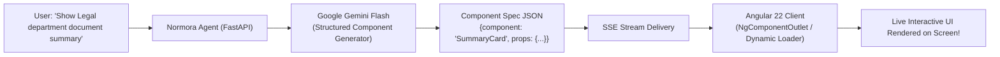
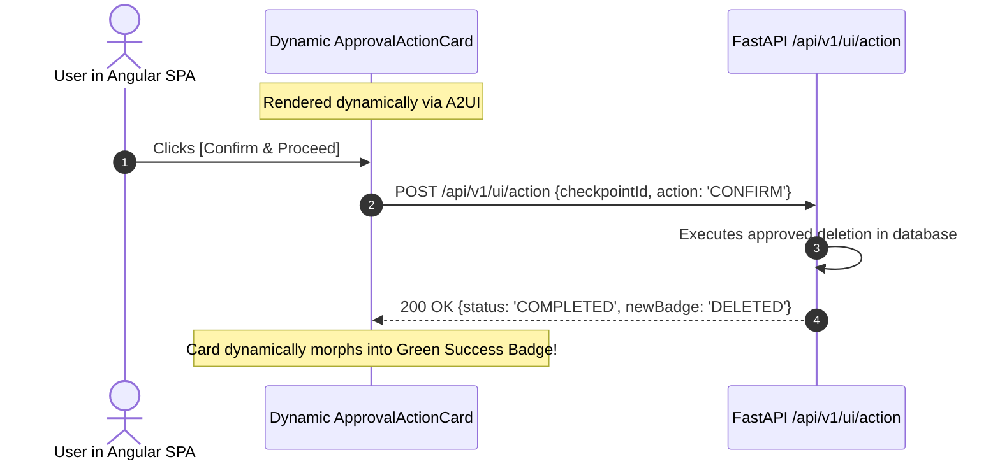

# Module 20: Agent-to-UI (A2UI) Generative Component Streaming

Welcome to **Module 20** of the Normora Python & AI Masterclass.

For years, chatbots were trapped in a markdown box: the user asked a question, and the model replied with paragraphs of text, bullet points, and code blocks.

**Agent-to-UI (A2UI) / Generative UI** is the next generation of user experience:
Instead of just streaming text, the AI model **streams structured UI component specifications** directly into the frontend. 

When a user in **Normora** asks:
* *"Show me the breakdown of documents in the Legal department"* — The agent does not return a wall of text; it generates a live, interactive **`DataTableComponent`** with sorting and filtering.
* *"Summarize this document"* — The agent delivers an interactive **`DocumentSummaryCard`** with collapsible key findings and a direct download button.
* *"I want to delete this collection"* — The agent generates an interactive **`ApprovalModalCard`** requiring confirmation.

In this module, you will master the architecture of Generative UI:
* Defining a component catalog using Pydantic contracts.
* Streaming UI deltas and props over Server-Sent Events (SSE).
* Rendering dynamic components progressively on Angular 22 / React clients.
* Handling bidirectional interactive UI callbacks.

Every concept is followed by **at least 5 real-world Normora examples**.

---

## 1. What is Generative UI (A2UI)?

In Generative UI, your backend and frontend share a **Component Catalog**:
1. The frontend registers a library of pre-built, beautifully styled Angular / React components (e.g. `MetricCard`, `DataTable`, `CitationPill`, `ApprovalModal`).
2. The backend instructs the AI model (Google Gemini Flash) to output JSON matching the props of these components.
3. The backend streams these component specifications over SSE to the frontend.
4. The frontend's dynamic component loader instantiates the matching Angular component on the screen!



---

## 2. Defining the Component Catalog Contracts with Pydantic

To prevent the LLM from hallucinating invalid props (e.g. putting strings where numbers belong), we define strict **Pydantic Discriminated Unions** representing our allowed UI catalog.

### 5 Real-World Normora Examples:

#### Example 2.1: The `DocumentSummaryCard` Component Schema
```python
from typing import Literal
from pydantic import BaseModel, Field

class DocumentSummaryCardProps(BaseModel):
    component: Literal["DocumentSummaryCard"] = "DocumentSummaryCard"
    title: str = Field(description="Document title")
    total_pages: int
    department: str
    key_findings: list[str] = Field(description="List of 3-5 bulleted highlights")
    urgency_badge: Literal["LOW", "MEDIUM", "HIGH"] = "LOW"

card = DocumentSummaryCardProps(
    title="Employee_Handbook_2026.pdf",
    total_pages=45,
    department="Human Resources",
    key_findings=["20 days PTO", "MFA mandatory by end of Q1"],
    urgency_badge="MEDIUM"
)
print(f"Component: <{card.component}> | Title: {card.title}")
```

#### Example 2.2: The `DataTableComponent` Schema
```python
class DataTableComponentProps(BaseModel):
    component: Literal["DataTableComponent"] = "DataTableComponent"
    headers: list[str]
    rows: list[list[str]]
    filterable: bool = True

table = DataTableComponentProps(
    headers=["Document Title", "Department", "Chunks", "Status"],
    rows=[
        ["Security_Standard.pdf", "Engineering", "48", "INDEXED"],
        ["Vacation_Policy.pdf", "HR", "12", "INDEXED"]
    ]
)
print(f"Table component generated with {len(table.rows)} rows.")
```

#### Example 2.3: The `DepartmentMetricMetricBar` Schema
```python
class MetricMetricBarProps(BaseModel):
    component: Literal["MetricMetricBar"] = "MetricMetricBar"
    metric_label: str
    current_value: float
    max_value: float
    unit: str

metric = MetricMetricBarProps(
    metric_label="Tenant Monthly Token Consumption",
    current_value=450_000,
    max_value=1_000_000,
    unit="tokens"
)
print(f"Metric: {metric.metric_label} ({metric.current_value}/{metric.max_value} {metric.unit})")
```

#### Example 2.4: The `ApprovalActionCard` Schema
```python
class ApprovalActionCardProps(BaseModel):
    component: Literal["ApprovalActionCard"] = "ApprovalActionCard"
    action_title: str
    action_type: str
    checkpoint_id: str
    consequences: list[str]
    confirm_label: str = "Confirm & Proceed"
    cancel_label: str = "Decline"

approval = ApprovalActionCardProps(
    action_title="Permanently Purge 2024 Audit Logs",
    action_type="DELETE_AUDIT_LOGS",
    checkpoint_id="chkpt-882",
    consequences=["Cannot be undone", "All historic compliance logs will be lost."]
)
print(f"Approval Card: {approval.action_title} (ID: {approval.checkpoint_id})")
```

#### Example 2.5: The Master Polymorphic `UiComponentCatalog`
```python
from typing import Union, Annotated

# The complete master catalog of all UI components allowed in Normora:
UiComponentSpec = Annotated[
    Union[
        DocumentSummaryCardProps,
        DataTableComponentProps,
        MetricMetricBarProps,
        ApprovalActionCardProps
    ],
    Field(discriminator="component")
]

class GenerativeUiMessage(BaseModel):
    text: str | None = None
    ui_component: UiComponentSpec | None = None

# Validation test:
msg = GenerativeUiMessage(
    text="Here is your departmental document report:",
    ui_component={
        "component": "DataTableComponent",
        "headers": ["Dept", "Docs"],
        "rows": [["Legal", "14"], ["HR", "8"]]
    }
)
print(f"Delivering UI payload of type: {type(msg.ui_component).__name__}")
```

---

## 3. Streaming Generative UI Over Server-Sent Events (SSE)

In traditional streaming, the server only streams strings.  
In Generative UI streaming, we stream **component lifecycle events**:
1. `event: ui_start`: Notifies the frontend which component to mount.
2. `event: ui_delta`: Streams props progressively as they are generated.
3. `event: ui_complete`: Signals that component data is finalized.

### 5 Real-World Normora Examples:

#### Example 3.1: Delivering Generative UI Stream in FastAPI
```python
import asyncio
import json
from fastapi import FastAPI
from fastapi.responses import StreamingResponse

app = FastAPI()

async def a2ui_stream_generator():
    # 1. Send introductory conversational text:
    yield "event: text\ndata: \"I have compiled the latest document summary:\"\n\n"
    await asyncio.sleep(0.05)

    # 2. Emit UI component initiation event:
    yield "event: ui_start\ndata: {\"component\": \"DocumentSummaryCard\"}\n\n"
    await asyncio.sleep(0.05)

    # 3. Deliver full validated component props:
    component_props = {
        "component": "DocumentSummaryCard",
        "title": "Employee Handbook 2026.pdf",
        "totalPages": 42,
        "department": "Human Resources",
        "keyFindings": [
            "16 weeks of paid parental leave",
            "Mandatory MFA on all internal tools",
            "$500 annual home office equipment budget"
        ],
        "urgencyBadge": "LOW"
    }
    yield f"event: ui_complete\ndata: {json.dumps(component_props)}\n\n"

@app.get("/api/v1/chat/generative-ui")
async def generative_ui_stream():
    return StreamingResponse(a2ui_stream_generator(), media_type="text/event-stream")
```

#### Example 3.2: Progressive Row-by-Row Streaming for Data Tables
For large datasets, stream table rows progressively as they are fetched:
```python
async def stream_table_rows():
    yield "event: ui_start\ndata: {\"component\": \"DataTableComponent\"}\n\n"
    
    rows = [
        ["Compliance_Guide.pdf", "Legal", "100%"],
        ["Engineering_Handbook.pdf", "Engineering", "95%"],
        ["Expense_Policy.pdf", "Finance", "92%"]
    ]
    for row in rows:
        await asyncio.sleep(0.04)
        yield f"event: ui_row\ndata: {json.dumps({'row': row})}\n\n"

    yield "event: ui_complete\ndata: {}\n\n"
```

#### Example 3.3: Streaming Vercel AI SDK Tool UI Cards
Using the Vercel AI SDK data stream protocol to trigger client-side Generative UI widgets:
```python
def stream_generative_widget_vercel(tool_call_id: str, component_props: dict) -> str:
    # Emits tool call result (Type 'a:') containing UI component spec:
    payload = {
        "toolCallId": tool_call_id,
        "result": {
            "__isGenerativeUi": True,
            "component": component_props["component"],
            "props": component_props
        }
    }
    return f"a:{json.dumps(payload)}\n"
```

#### Example 3.4: Dynamic Theme Injection for White-Label Tenants
Inject the tenant's custom branding palette into the component props dynamically:
```python
def inject_tenant_branding(props: dict, tenant_branding: dict) -> dict:
    props["theme"] = {
        "primaryColor": tenant_branding.get("primary_color", "#0ea5e9"),
        "borderRadius": tenant_branding.get("border_radius", "8px")
    }
    return props
```

#### Example 3.5: Client Fallback Handling
If a client does not support Generative UI, automatically fall back to rendering standard markdown tables:
```python
def build_fallback_markdown(table_props: DataTableComponentProps) -> str:
    md = "| " + " | ".join(table_props.headers) + " |\n"
    md += "| " + " | ".join(["---"] * len(table_props.headers)) + " |\n"
    for row in table_props.rows:
        md += "| " + " | ".join(row) + " |\n"
    return md

print(build_fallback_markdown(table))
```

---

## 4. Handling Bidirectional UI Interactions

Generative UI is not just read-only: **it is interactive**.  
When a user clicks a button on a dynamically rendered `ApprovalActionCard` or selects a row on a `DataTableComponent`, that event sends an interactive action callback back to the FastAPI backend!



### 5 Real-World Normora Examples:

#### Example 4.1: The Interactive UI Action Payload Schema
```python
class UiActionCallback(BaseModel):
    checkpoint_id: str
    action_type: str
    user_decision: Literal["CONFIRM", "DECLINE"]
    client_metadata: dict = Field(default_factory=dict)

action_payload = {
    "checkpoint_id": "chkpt-882",
    "action_type": "DELETE_AUDIT_LOGS",
    "user_decision": "CONFIRM"
}
callback = UiActionCallback(**action_payload)
print(f"Action: {callback.action_type} -> Decision: {callback.user_decision}")
```

#### Example 4.2: FastAPI UI Action Dispatcher Endpoint
```python
@app.post("/api/v1/ui/action")
async def handle_ui_action(callback: UiActionCallback):
    if callback.user_decision == "CONFIRM":
        print(f"Executing confirmed action for checkpoint: {callback.checkpoint_id}")
        return {
            "success": True,
            "updatedComponent": {
                "component": "StatusBadgeCard",
                "props": {"status": "SUCCESS", "message": "Audit logs permanently deleted."}
            }
        }
    else:
        print(f"Action declined for checkpoint: {callback.checkpoint_id}")
        return {
            "success": True,
            "updatedComponent": {
                "component": "StatusBadgeCard",
                "props": {"status": "CANCELLED", "message": "Operation cancelled by user."}
            }
        }
```

#### Example 4.3: Table Row Selection Action Trigger
When a user clicks a document in the generated table to view citations:
```python
class TableRowClickAction(BaseModel):
    document_id: str
    selected_page: int

@app.post("/api/v1/ui/row-select")
async def on_table_row_click(event: TableRowClickAction):
    print(f"User navigated to Document {event.document_id} on Page {event.selected_page}")
    return {"navigated": True}
```

#### Example 4.4: Dynamic Filter Trigger
```python
class FilterChangeAction(BaseModel):
    department: str

@app.post("/api/v1/ui/filter-change")
async def on_filter_change(event: FilterChangeAction):
    print(f"Re-filtering generative table for department: {event.department}")
    return {"updated": True}
```

#### Example 4.5: Angular 22 Client Dynamic Component Outlet Pattern
In Angular 22, the incoming component name is bound dynamically:
```html
<!-- Angular Standalone Component: generative-ui-host.component.html -->
<div *ngIf="activeComponentSpec() as spec">
  <ng-container [ngComponentOutlet]="resolveComponent(spec.component)"
                [ngComponentOutletInputs]="spec.props">
  </ng-container>
</div>
```

---

## Summary & Next Step

You have mastered Generative UI (A2UI):
1. Moving beyond markdown to rich dynamic components.
2. Defining strict Component Catalogs using Pydantic Discriminated Unions.
3. Streaming component initialization, deltas, and completion over SSE.
4. Handling bidirectional user interactions and morphing UI cards on confirmation.

In our final module, **Module 21**, we bring everything together for the grand finale: **Production Hardening, Tracing, Security Defense & Docker Deployment**!
